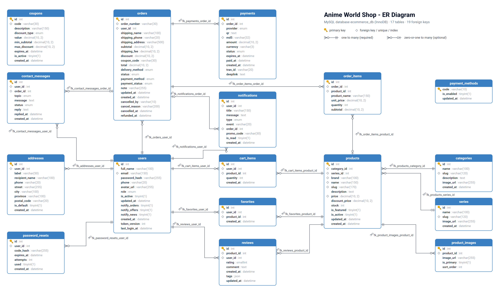

{width=3.6in}\

::: {custom-style="Title"}
Anime World Shop
:::

::: {custom-style="Subtitle"}
E-Commerce Mobile Application - Complete Project Documentation
:::

**Course:** Mobile Application (Year 4, SU25) - Final Project\
**Institute:** SETEC Institute\
**Date:** 23 October 2026\
**Source code:** <https://github.com/Vanchha16/MA_Final>

**Lecturer:** Ly Lay

**Team members**

| No. | Name |
|---|---|
| 1 | Loum Vanchha |
| 2 | Hong Dalin |
| 3 | Khounn Eangleng |
| 4 | Sour Sombo |
| 5 | Rem Sophannary |

```{=openxml}
<w:p><w:r><w:br w:type="page"/></w:r></w:p>
```


## Contents

1. Project Overview
2. Requirement Analysis
3. Use Case Diagram and Specifications
4. Database Design and ER Diagram
5. API Documentation
6. Installation and Running the Project
7. Bonus Features
8. Testing
9. Project Deliverables Checklist

Appendix A. Database Schema (SQL)

```{=openxml}
<w:p><w:r><w:br w:type="page"/></w:r></w:p>
```

# 1. Project Overview

**Anime World Shop** is an online shop for anime figures, plush, model kits and anime trading
card games (One Piece, Pokemon, Yu-Gi-Oh! ...). Customers shop in a Flutter mobile app; the shop
team runs the shop from the same app (admin tabs) or from a web admin on a computer. Everything
talks to one Flask REST API backed by a MySQL database.

## 1.1 System parts

| Part | Who uses it | Technology |
|---|---|---|
| Mobile app (customer) | Shoppers | Flutter 3, Dart, Provider, Dio |
| Mobile app (admin tabs) | Shop owner (admin) and staff | Flutter (same app, opened by an admin or staff account) |
| REST API | The app and the web admin | Python Flask, SQLAlchemy, Flask-JWT-Extended, bcrypt |
| Web admin | Shop owner and staff on a computer | React 18, Vite, Tailwind CSS, Recharts (at `/dashboard`) |
| Admin panel (fallback) | Shop owner | Flask-Admin (at `/admin`) |
| Database | All of the above | MySQL 8 (InnoDB, 16 tables, 19 foreign keys) |
| Payments | Customers | Bakong KHQR (bakong-khqr) and ABA PayWay (signed REST calls) |
| Source control | The team | Git and GitHub (https://github.com/Vanchha16/MA_Final) |

## 1.2 Architecture

```
 Flutter app (customer + admin)      React web admin (/dashboard)
               \                          /
                \   HTTPS JSON (JWT)     /
                 v                       v
            Flask REST API  (/api/...)  +  Flask-Admin (/admin)
                 |            |                  |
              MySQL      Bakong KHQR API     ABA PayWay API
          (ecommerce_db)
```

Every API response has the same shape `{success, message, data}`; errors add an `errors`
object that says which field is wrong. Logged-in calls send `Authorization: Bearer <token>`.

## 1.3 Demo accounts

| Account | Email | Password | Can do |
|---|---|---|---|
| Customer | demo@shop.com | demo123 | Shop, pay, track orders, review |
| Admin (shop owner) | admin@shop.com | demo123 | Everything, including staff, promo codes, blocking customers |
| Staff | staff@shop.com | demo123 | Orders, products, categories, messages, reviews; view customers |


```{=openxml}
<w:p><w:r><w:br w:type="page"/></w:r></w:p>
```

# 2. Requirement Analysis

**Project:** E-Commerce Mobile Application (SETEC Institute, Year 4 Mobile Application, SU25 Final Project)
**Product:** Anime World Shop - a mobile shop for anime figures, plush, merchandise and trading card games (TCG)
**Version:** 1.0 - 16 October 2026


## 2.1 Introduction

### 2.1.1 Purpose
This document describes what Anime World Shop must do (functional requirements), how well it must do it (non-functional requirements) and the business rules it follows. It is the reference for the design, the database, the API and the tests, and every requirement is traced back to the project brief in section 10.

### 2.1.2 Problem statement
Anime collectors in Cambodia mostly buy figures and cards through Facebook pages and Telegram chats. Customers have to ask for the price and stock of every item, send payment screenshots by hand, and have no way to follow their order. Shop owners keep stock and orders in chat history and spreadsheets.

### 2.1.3 Product scope
Anime World Shop is made of three parts that share one database:

| Part | Who uses it | Built with |
|---|---|---|
| **Mobile app - customer side** | Shoppers | Flutter (Android, iOS, web) |
| **Mobile app - admin side** | Shop owner and staff (same app, opened by an admin or staff account) | Flutter |
| **Backend REST API + web admin panel** | The mobile app; staff on a computer (`/admin`) | Python Flask, MySQL |

In scope: accounts, catalogue, search and filters, cart, wishlist, checkout, KHQR, ABA PayWay and cash on delivery payment, order tracking, receipts, product reviews and ratings, notifications, contact messages, settings, and the shop management tools.
Out of scope for version 1.0: delivery-company integration, automatic refunds through the payment provider (the shop sends refunds itself and records them in the app), multiple shops (marketplace) and loyalty point redemption.

### 2.1.4 Definitions

| Term | Meaning |
|---|---|
| KHQR | Cambodia's national QR payment standard (Bakong). Any Cambodian bank app can pay a KHQR code. |
| ABA PayWay | ABA Bank's online payment gateway. It gives a KHQR code and a link that opens the ABA Mobile app with the payment filled in. |
| COD | Cash on delivery |
| Series | The anime a product belongs to, e.g. One Piece, Jujutsu Kaisen, Pokemon |
| TCG | Trading card game (booster boxes, structure decks) |
| JWT | JSON Web Token, the login token the app sends with every request |
| OTP / reset code | The 6-digit code emailed for "Forgot password" |
| Must / Should / Could | Priority of a requirement (MoSCoW) |


## 2.2 Stakeholders and users

| Stakeholder | Role | Main needs |
|---|---|---|
| **Customer** | Buys products | Find items fast, see real stock and prices, pay easily, know where the order is |
| **Visitor** | Has not signed in yet | Create an account, sign in, recover a forgotten password |
| **Admin (shop owner)** | Owns the shop | Everything staff do, plus manage staff accounts, promo codes and blocked customers |
| **Staff** | Runs the shop day to day | Handle new orders quickly, keep stock right, add products, answer customers |
| **Bakong KHQR** (external system) | Payment network | Receives the QR payment request and reports when it is paid |
| **ABA PayWay** (external system) | Payment gateway | Creates a PayWay payment (KHQR + ABA Mobile link), reports its status and posts the result back |
| **Email service** (external system) | Sends mail | Delivers password reset codes |
| **Lecturer / assessor** | Grades the project | Brief coverage, documentation, working demo |
| **Development team** | Builds and maintains the system | Clear requirements, tests, readable code |

The actors and their use cases are drawn in the Use Case Diagram.


## 2.3 Technology selection

The brief lets each team choose its backend technology. Our choices and the reasons:

| Layer | Choice | Why |
|---|---|---|
| Mobile app | **Flutter 3 / Dart** | Required by the brief; one code base for Android, iOS and web |
| State management | **Provider** | Simple, official recommendation, easy for the whole team to read |
| HTTP client | **Dio** | Interceptors add the login token and turn errors into one exception type |
| Backend | **Python Flask** (Blueprints) | Small and readable; easy to build a JSON API |
| ORM | **SQLAlchemy** | Models in Python, same code for MySQL and the SQLite test database |
| Database | **MySQL 8** | Relational data with foreign keys fits orders, items and stock; matches the ERD |
| Security | **Flask-JWT-Extended**, **bcrypt** | Stateless login tokens; passwords stored as salted hashes |
| Payment | **bakong-khqr** package | Generates real KHQR codes and checks their payment status |
| Payment | ABA PayWay API (**requests**) | Signed (HMAC-SHA512) purchase and check-transaction calls |
| API documentation | **OpenAPI 3 + Swagger UI** | Interactive docs at `/api/docs`, plus a generated Markdown copy |
| Web admin | **React 18 + Vite + Tailwind CSS + Recharts** (at `/dashboard`) and **Flask-Admin** (at `/admin`) | A modern desktop dashboard on the same JSON API, plus a server-rendered fallback |
| Localisation | **flutter_localizations / gen-l10n** | English and Khmer |
| Source control | **Git + GitHub** | Required by the brief; one branch per feature |


## 2.4 Functional requirements

Priority: **M** = Must (in the brief), **S** = Should (needed for a real shop), **C** = Could (bonus). Status: all requirements below are implemented in version 1.0 unless marked *Planned*.

### 2.4.1 User management (FR-U)

| ID | Requirement | Priority |
|---|---|---|
| FR-U01 | The app shows a **splash screen** with the logo while it checks for a saved login, then opens the shop (customer), the admin area (admin or staff) or the login screen. | M |
| FR-U02 | A visitor can **register** with full name, email, password and an optional phone number. | M |
| FR-U03 | A user can **log in** with email and password and stays logged in until they log out. | M |
| FR-U04 | A user who **forgot the password** can request a 6-digit code by email, enter it, and choose a new password. | M |
| FR-U05 | A customer can view their **profile**: photo, name, email, phone, order counts by status and member level. | M |
| FR-U06 | A customer can **edit the profile** (name, phone, profile photo). | M |
| FR-U07 | A logged-in user can **change the password** after entering the current one. | S |
| FR-U08 | A customer can add, edit, delete and choose a default **delivery address**. | S |
| FR-U09 | A user can **log out**; the app asks for confirmation first. | M |
| FR-U10 | Accounts have a **role** (customer, staff or admin); shop screens and API calls are refused for customers, and owner-only ones (staff, promo codes, blocking customers) for staff. | M |

### 2.4.2 Product browsing (FR-P)

| ID | Requirement | Priority |
|---|---|---|
| FR-P01 | The **home screen** shows promotion banners, anime series tabs, featured products and new arrivals. | M |
| FR-P02 | The customer can browse **product categories** with the number of products in each. | M |
| FR-P03 | A **product list** shows photo, name, price, sale price and stock, as a grid or a list. | M |
| FR-P04 | **Product details** show all photos, description, brand, series, category, price, sale price and stock, with Add to cart and wishlist buttons. | M |
| FR-P05 | The customer can **search** by product name, brand or series, with suggestions while typing and recent searches. | M |
| FR-P06 | The customer can **filter** by category, series, brand (several at once), price range and "in stock only", and **sort** by newest, price (low-high, high-low) or name. | M |
| FR-P07 | Hidden products (`is_active = false`) never appear in the shop. | S |

### 2.4.3 Cart and wishlist (FR-C)

| ID | Requirement | Priority |
|---|---|---|
| FR-C01 | The customer can **add a product to the cart** from the list or details screen, with a visible confirmation. | M |
| FR-C02 | The customer can **update the quantity** of a cart line, up to the available stock. | M |
| FR-C03 | The customer can **remove a product** from the cart, or empty the whole cart after confirming. | M |
| FR-C04 | The cart shows subtotal, delivery fee, discount and total, and how much more is needed for free delivery. | S |
| FR-C05 | The customer can **apply a coupon code** in the cart; invalid or expired codes show the reason. | S |
| FR-C06 | The customer can **add and remove wishlist (favourite) products**, view them as swipe cards, a board or a selectable list, and move selected items to the cart. | M |

### 2.4.4 Orders and payment (FR-O)

| ID | Requirement | Priority |
|---|---|---|
| FR-O01 | **Checkout** lets the customer choose the delivery address, delivery method (standard delivery or store pickup) and payment method (KHQR, ABA PayWay or cash on delivery), and add a note. | M |
| FR-O02 | Placing the order checks stock again, creates the order and its items, lowers stock and empties the cart. | M |
| FR-O03 | An **order confirmation** screen shows the order number, total and next steps. | M |
| FR-O04 | For KHQR orders the app shows a **KHQR code** with a countdown; the app detects the payment automatically and shows a receipt. | C (bonus: online payment) |
| FR-O04b | For **ABA PayWay** orders the app shows PayWay's KHQR with a countdown and an **Open ABA Mobile** button (or a link to get the app); the payment is detected the same way and a receipt is printed. | C (bonus: online payment) |
| FR-O05 | **Order history** lists the customer's orders, current ones first, with status and photos. | M |
| FR-O06 | **Order details** show a status tracker (placed, paid, shipped, delivered), items, address, payment and totals. | M |
| FR-O07 | The customer can **confirm an order was received**, **buy the same items again**, and **view, save or share the receipt** of a paid order. | S |
| FR-O08 | The customer can **cancel an order** until it ships (pending or confirmed), with an optional reason (changed my mind, ordered by mistake, found a better price, it takes too long). The stock goes back on sale. If it was paid by KHQR or ABA PayWay, the order shows **Refund pending**, then **Refunded** once the shop has sent the money back; each step is a notification. | S |

### 2.4.5 Additional features (FR-A)

| ID | Requirement | Priority |
|---|---|---|
| FR-A01 | **Notifications** tell the customer when an order is placed, paid, confirmed, shipped, delivered or cancelled, and when the shop answers a message; unread ones are counted on the bell icon and can be marked read or deleted. | M |
| FR-A02 | **Settings** let the user choose light, dark or system theme and English or Khmer, and save which kinds of notification they want (orders, offers, news). | M |
| FR-A03 | An **About** screen shows the shop, the app version and credits; **Privacy policy** and **Terms of use** pages are available. | M |
| FR-A04 | A **Contact** screen shows the shop's Telegram, phone, email, address and hours, and lets the customer send a message about an order, payment, product or anything else. | M |
| FR-A05 | A **Help** screen answers common questions. | S |

### 2.4.6 Reviews and ratings (FR-R)

| ID | Requirement | Priority |
|---|---|---|
| FR-R01 | A customer can **rate a product delivered to them** with 1-5 stars, quick tags (Great quality, As pictured, Well packed, Fast delivery, Good value) and an optional comment, from the order details, the "Rate it" notification, Profile > To review or the product page. | C (bonus) |
| FR-R02 | A customer has one review per product and can **edit or delete** it. | C |
| FR-R03 | **Product details** show the average rating and review count, and the customer's own review (or the newest). | C |
| FR-R04 | A **Reviews** page shows the score, a 5-to-1 star chart and all reviews, filterable by star level or "with comments", the customer's own review first. | C |
| FR-R05 | Every review is marked as a **verified buyer**. | C |

### 2.4.7 Shop administration (FR-AD)

| ID | Requirement | Priority |
|---|---|---|
| FR-AD01 | An admin account opens an **admin dashboard**: total revenue, revenue for the last 7 days, orders to handle, low stock, open messages and a live activity feed with one-tap actions. The dashboard refreshes every 20 seconds. | S |
| FR-AD02 | The admin can **search and filter orders** by status and move an order to its next step (confirm, ship, deliver) or cancel it. The customer is notified each time. | M |
| FR-AD03 | The admin can **add, edit, hide and delete products**: name, category, series, brand, price, sale price, stock, featured, description and photos. | M |
| FR-AD04 | The admin can **add, rename and delete categories**. | M |
| FR-AD05 | The admin can **view customers** with their order count, total spent, addresses and orders, and **block or unblock** a customer. | M |
| FR-AD06 | The admin can **read and answer contact messages**; the answer reaches the customer as a notification. | S |
| FR-AD07 | The shop can be managed on a computer in a **React web admin** at `/dashboard`: the same dashboard as the app (revenue, 7-day chart, orders to handle with one-click steps, live activity with Reply / Restock, low stock with +5, refreshing every 20 seconds) and pages for orders, products with photos, categories, customers, messages, reviews and coupons, with a Light / Dark / System theme switch. | C |
| FR-AD08 | A server-rendered **admin panel** at `/admin` (Flask-Admin) offers the same dashboard and one-click actions, as a fallback that needs no JavaScript build. | C |
| FR-AD09 | The admin can **manage promo codes** (add, edit, switch off, delete) and **remove reviews** (spam, rude words). | C |
| FR-AD10 | The admin (owner) can **manage staff accounts** in the app and the web admin: add a staff or admin account with a starting password, change the name, phone and role, reset the password and disable / enable the account. A new role, a new password or disabling signs that person out at once. Nobody can change their own role or disable themselves, and the shop always keeps one active admin. | S |
| FR-AD12 | The shop sees cancelled paid orders as **Refund to send** (filter in Orders, "Refund" in Live activity, a count in the dashboard numbers), sends the money back itself (bank transfer or ABA) and taps **Mark refunded**; the customer is notified. When the shop cancels an order it can give a reason, which the customer sees. | S |
| FR-AD11 | A **staff** account opens the same admin area but only sees what staff may do: dashboard, orders, products, categories, messages, reviews and customers (view only). Staff, Coupons and Block customer are hidden, and the API refuses them (403). | S |


## 2.5 Backend and API requirements

### 2.5.1 Core functions (from the brief)

| ID | Core function | How the backend provides it |
|---|---|---|
| BE-01 | User authentication and authorization | `/api/auth/*` (register, login, me, forgot password, verify code, reset password); JWT on every protected route; role check on `/api/admin/*` (staff or admin; owner-only routes need admin); blocked users refused |
| BE-02 | Product management | Public `/api/products`, `/api/products/<id>`, search suggestions; admin `/api/admin/products` create, update, delete, photos, stock |
| BE-03 | Category management | Public `/api/categories`; admin `/api/admin/categories` create, rename, delete |
| BE-04 | Customer management | Own profile `/api/profile`, addresses `/api/addresses`, preferences; admin `/api/admin/customers` list, details, block; staff accounts `/api/admin/staff` list, add, change, disable |
| BE-05 | Shopping cart management | `/api/cart` add, update quantity, remove, clear, coupon; wishlist `/api/wishlist` |
| BE-06 | Order management | `/api/checkout`, `/api/orders` place, list, details, received, cancel, KHQR and ABA PayWay payment, PayWay callback; admin `/api/admin/orders` list, details, status, refund |
| BE-07 | API for the mobile app | 64 REST endpoints, JSON in and out, documented (section 5.2) |

### 2.5.2 API requirements

| ID | Requirement |
|---|---|
| API-01 | All requests and responses use **JSON** (photo uploads use multipart form data). |
| API-02 | Every response has the same envelope: `{"success": true/false, "message": "...", "data": ...}`; errors add `"errors"`. |
| API-03 | **Validation** happens on the server for every input: types (text, whole numbers, true/false), lengths that fit the database columns, ranges and allowed values. A `422` response lists each wrong field, e.g. `{"email": "Email is not valid"}`; a wrong value never causes a server error. |
| API-04 | Errors use the right HTTP status: `400` bad request, `401` not logged in, `403` not allowed or blocked, `404` not found, `409` conflict (e.g. not enough stock), `422` validation, `429` too many attempts, `500` unexpected error (still JSON). |
| API-05 | Lists are **paginated** (`page`, `per_page`, `total`, `total_pages`). |
| API-06 | The API is **documented** with OpenAPI 3: interactive Swagger UI at `/api/docs` and `docs/API.md`; an automated test fails if any route is not documented. |


## 2.6 Non-functional requirements

| ID | Category | Requirement | How it is met / verified |
|---|---|---|---|
| NFR-01 | Usability | Modern, clean, consistent UI; a new user can find a product and check out without help. | One design system (Roboto, sky-blue brand colours, rounded cards); every screen designed in Figma first; empty, loading and error states on every list |
| NFR-02 | Usability | Clear feedback for every action. | Snack bars, toasts, confirmation dialogs for destructive actions (red button), field errors under inputs |
| NFR-03 | Accessibility | Text and icons readable in light and dark mode; touch targets at least 40 px. | Dark theme with its own colour scheme; Material icons with tooltips |
| NFR-04 | Localisation | The app works in English and Khmer and remembers the choice. | gen-l10n `.arb` files; customer screens translated (admin tools in English for v1.0) |
| NFR-05 | Performance | Screens show data within about 2 seconds on a normal connection; lists load in pages; photos are cached. | Pagination (max 50 per page), photos cached on the device with `cached_network_image` |
| NFR-06 | Security | Passwords are never stored in plain text. | bcrypt hashes |
| NFR-07 | Security | Only logged-in users reach their own data; only shop staff reach shop data, and only the owner manages staff. | JWT (7-day expiry), ownership checks on every order/address/cart query, role check, blocked accounts rejected |
| NFR-08 | Security | Passwords and reset codes cannot be brute-forced, and the shop cannot be flooded. | Login: 10 tries a minute per network and 10 per 15 minutes per email; sign-up: 20 an hour per network; contact: 5 messages in 10 minutes and 30 a day per account (Flask-Limiter, `429`). Reset code valid 10 minutes, locked after 5 wrong tries, 60 s between requests, max 5 requests per hour |
| NFR-08b | Security | Changing or resetting the password signs out the account's other devices. | A token version in each login token; older tokens get `401` |
| NFR-09 | Security | Secrets are not in the source code. | `.env` file (git-ignored) for database URL, secret keys, Bakong token and PayWay API key |
| NFR-10 | Reliability | Stock can never go below zero, even when two customers buy the last item at the same moment, and an order is all-or-nothing. | Each item's stock is taken with one conditional `UPDATE ... WHERE stock >= quantity` inside the order's transaction; if it no longer matches, the whole order is rolled back with `409` |
| NFR-11 | Reliability | Unpaid KHQR / ABA PayWay orders do not hold stock forever. | Cancelled and restocked after 15 minutes |
| NFR-12 | Maintainability | Code is organised and tested. | Flask Blueprints, Flutter screens/services/providers folders; 87 backend tests (pytest) and 169 Flutter tests; `flutter analyze` with no issues |
| NFR-13 | Portability | Runs on Android, iOS and the web. | Flutter; API base URL in one constant |
| NFR-14 | Compatibility | The backend works with MySQL in use and SQLite in tests. | SQLAlchemy models; `flask init-db` creates the tables |


## 2.7 Business rules

| ID | Rule |
|---|---|
| BR-01 | An email address can register only once. Passwords have at least 6 characters. |
| BR-02 | Delivery is free when the subtotal is $50 or more; otherwise standard delivery costs $2. Store pickup is always free. |
| BR-03 | A cart quantity cannot exceed the product's stock; sold-out or hidden products cannot be ordered. |
| BR-04 | A coupon is valid only if it is active, not expired, and the subtotal reaches its minimum. Percentage coupons can have a maximum discount. |
| BR-05 | Order numbers are unique and readable, e.g. `AWS-20261016-00042`: the date plus the order's own id, so two orders placed at the same moment never share a number. |
| BR-06 | Orders move only forward: pending -> confirmed -> shipped -> delivered. Pending and confirmed orders can be cancelled, by the customer or the shop; shipped and delivered orders cannot. |
| BR-07 | An unpaid KHQR or ABA PayWay order cannot be confirmed; it waits for payment or is cancelled after 15 minutes, and its stock is returned. |
| BR-08 | Cancelling an order returns its items to stock. |
| BR-09 | A category can be deleted only when it has no products. |
| BR-10 | A blocked customer cannot log in or use an existing token until an admin unblocks them. |
| BR-12 | A disabled staff account cannot log in or use an existing token. Admins cannot change their own role or disable themselves, and the last active admin cannot be demoted or disabled. |
| BR-13 | Cancelling an order that was paid by KHQR or ABA PayWay makes its payment **refund_pending**; only the shop can mark it **refunded**, and refunded or pending money is not counted as revenue. Cash on delivery orders are never paid before delivery, so they need no refund. |
| BR-11 | A product's sale price must be lower than its normal price; stock is 0 or more. |
| BR-12 | Each status change and each answer to a message creates a notification for the customer. |
| BR-13 | Only a customer who received a product (a delivered order containing it) can review it; one review per customer and product, and posting again edits it. A comment has at most 1,000 characters. |


## 2.8 Data requirements

The system stores 16 entities. The nine suggested in the brief are all present:

| Brief entity | Table | Extra tables we needed |
|---|---|---|
| Users | `users` | `password_resets` - reset codes |
| Categories | `categories` | `series` - anime franchise of a product |
| Products | `products` | `coupons` - promo codes |
| Product Images | `product_images` | `payments` - KHQR and ABA PayWay payments |
| Cart | `cart_items` | `notifications` |
| Orders | `orders` | `contact_messages` |
| Order Items | `order_items` | `reviews` - star ratings, tags and comments |
| Addresses | `addresses` | |
| Favorites / Wishlist | `favorites` | |

Order items copy the product name and unit price at the time of purchase, so old orders stay correct after a price change. Full diagram: ERD (PNG, PDF); full definitions: schema.sql.


## 2.9 Screen inventory

The brief asks for at least 20 screens. The app has **44** (32 customer, 12 admin), plus sheets such as Filter, Rate a product and To review.

| # | Screen | Brief item | # | Screen | Brief item |
|---|---|---|---|---|---|
| 1 | Splash | Splash Screen | 22 | My Orders | Order History |
| 2 | Login | Login | 23 | Order Details | Order Details |
| 3 | Register | Register | 24 | Receipt | (extra) |
| 4 | Forgot Password | Forgot Password | 25 | Notifications | Notifications |
| 5 | Verify Code | Forgot Password | 26 | Settings | Settings |
| 6 | Reset Password | Forgot Password | 27 | My Addresses | (extra) |
| 7 | Password Changed | Forgot Password | 28 | Help | (extra) |
| 8 | Profile | User Profile | 29 | Contact Us | Contact Information |
| 9 | Edit Profile | Edit Profile | 30 | About | About Application |
| 10 | Change Password | (extra) | 31 | Privacy Policy / Terms | (extra) |
| 11 | Home | Home Screen | 32 | Admin Dashboard | (admin) |
| 12 | Categories | Product Categories | 33 | Admin Orders | (admin) |
| 13 | Product List | Product List | 34 | Admin Order Details | (admin) |
| 14 | Product Details | Product Details | 35 | Admin Products | (admin) |
| 15 | Search | Search Products | 36 | Add / Edit Product | (admin) |
| 16 | Filter (sheet) | Product Filtering | 37 | Admin More | (admin) |
| 17 | Cart | Shopping Cart, Update Quantity, Remove | 38 | Admin Categories | (admin) |
| 18 | Wishlist | Wishlist / Favorite Products | 39 | Admin Customers | (admin) |
| 19 | Checkout (+ address form) | Checkout | 40 | Admin Customer Details | (admin) |
| 20 | KHQR / ABA PayWay Payment | (bonus: online payment) | 41 | Admin Messages | (admin) |
| 21 | Order Placed | Order Confirmation | 42 | Reviews | (bonus: reviews and ratings) |
| | | | 43 | Admin Staff | (admin only) |
| | | | 44 | Add / Edit Staff Member | (admin only) |

"Add to Cart" is a feature on Product List and Product Details (with an animation and an "Added to cart" sheet), so it has no separate screen. Screenshots of each screen are in `docs/screenshots/` on the `store-info` branch of the repository.


## 2.10 Requirements traceability matrix

Each item of the brief, the requirements that cover it and where it is implemented.

| Brief item | Requirement(s) | Implementation (app / API) | Status |
|---|---|---|---|
| UI/UX: modern, clean, smooth navigation | NFR-01, NFR-02 | Figma file, design system, bottom navigation | Done |
| Splash Screen | FR-U01 | `splash_screen.dart` | Done |
| Login | FR-U03 | `login_screen.dart` / `POST /api/auth/login` | Done |
| Register | FR-U02 | `register_screen.dart` / `POST /api/auth/register` | Done |
| Forgot Password | FR-U04 | `forgot_password`, `verify_code`, `reset_password` screens / `/api/auth/forgot-password`, `verify-otp`, `reset-password` | Done |
| User Profile | FR-U05 | `profile_screen.dart` / `GET /api/profile/summary` | Done |
| Edit Profile | FR-U06 | `edit_profile_screen.dart` / `PUT /api/profile`, `POST /api/profile/avatar` | Done |
| Home Screen | FR-P01 | `home_screen.dart` / `GET /api/products?featured=1`, `/api/series` | Done |
| Product Categories | FR-P02 | `categories_screen.dart` / `GET /api/categories` | Done |
| Product List | FR-P03 | `product_list_screen.dart` / `GET /api/products` | Done |
| Product Details | FR-P04 | `product_details_screen.dart` / `GET /api/products/<id>` | Done |
| Search Products | FR-P05 | `search_screen.dart` / `GET /api/products?q=`, `/api/search/suggestions` | Done |
| Product Filtering | FR-P06 | `filter_sheet.dart` / query parameters on `/api/products` | Done |
| Shopping Cart | FR-C04 | `cart_screen.dart` / `GET /api/cart` | Done |
| Add to Cart | FR-C01 | `POST /api/cart` | Done |
| Update Quantity | FR-C02 | `quantity_chip.dart` / `PUT /api/cart/<id>` | Done |
| Remove Product from Cart | FR-C03 | `DELETE /api/cart/<id>`, `DELETE /api/cart` | Done |
| Wishlist / Favorite Products | FR-C06 | `wishlist_screen.dart` / `/api/wishlist/*` | Done |
| Checkout | FR-O01, FR-O02 | `checkout_screen.dart` / `GET /api/checkout`, `POST /api/orders` | Done |
| Order Confirmation | FR-O03 | `order_placed_screen.dart` | Done |
| Order History | FR-O05 | `orders_screen.dart` / `GET /api/orders` | Done |
| Order Details | FR-O06, FR-O07, FR-O08 | `order_details_screen.dart` / `GET /api/orders/<id>`, `POST /api/orders/<id>/cancel` | Done |
| Notifications | FR-A01 | `notifications_screen.dart` / `/api/notifications/*` | Done |
| Settings | FR-A02 | `settings_screen.dart` / `/api/profile/preferences` | Done |
| About Application | FR-A03 | `about_screen.dart`, `legal_screen.dart` | Done |
| Contact Information | FR-A04 | `contact_screen.dart` / `/api/contact` | Done |
| Backend core functions (7) | BE-01 ... BE-07 | `backend/app/routes/*.py` | Done |
| API: JSON, errors and validation, docs | API-01 ... API-06 | `app/errors.py`, `app/api_docs.py`, `/api/docs`, `docs/API.md` | Done |
| Database: ERD and schema | Section 8 | `docs/database/` | Done |
| Flutter, Dart, state management | Section 3 | Provider | Done |
| Git and GitHub | Section 3 | github.com/Vanchha16/MA_Final | Done |
| Bonus: online payment | FR-O04, FR-O04b | KHQR (Bakong) and ABA PayWay | Done |
| Bonus: multi-language | FR-A02, NFR-04 | English / Khmer | Done |
| Bonus: dark mode | FR-A02 | Light / dark / system | Done |
| Bonus: advanced search and filtering | FR-P05, FR-P06 | Suggestions, multi-brand, price range, sort | Done |
| Bonus: product reviews and ratings | FR-R01 ... FR-R05 | `review_sheet.dart`, `reviews_screen.dart`, `to_review_sheet.dart` / `/api/products/<id>/reviews`, `/api/reviews/to-review` | Done |


## 2.11 Constraints, assumptions and future work

**Constraints**
- Built and demonstrated by a student team within one term; the backend runs on a local computer (WAMP MySQL on port 3306) for the demo.
- KHQR takes real payments through Bakong: the server needs a Bakong Open API token (`BAKONG_TOKEN`, renewed about every 90 days) and the receiving account (`BAKONG_ACCOUNT_ID`).
- ABA PayWay uses the merchant id and API key from ABA (`PAYWAY_MERCHANT_ID`, `PAYWAY_API_KEY`). The project uses PayWay's **sandbox**: its test QR cannot be paid by a real bank app, so a real PayWay payment needs production keys. PayWay's pushback needs a public address (`PAYWAY_CALLBACK_URL`); without it the app's status checks find the payment.
- Reset codes are printed in the server console in development (`MAIL_MODE=console`); real email needs SMTP settings.

**Assumptions**
- Customers have a smartphone with internet access and a Cambodian bank app for KHQR (ABA Mobile for the quickest ABA PayWay payment).
- Prices are in US dollars; delivery is within Phnom Penh.
- Product photos are the brands' official images, used for educational purposes only.

**Future work**
- Use the saved notification choices to filter which notifications are sent (v1.0 stores them but sends all order notifications).
- Khmer translation of the admin tools; push notifications (Firebase); deployment to a cloud server.


```{=openxml}
<w:p><w:r><w:br w:type="page"/></w:r></w:p>
```

# 3. Use Case Diagram and Specifications


## 3.1 Actors

| Actor | Type | Description |
|---|---|---|
| **User (not signed in)** | Primary | Anyone who opens the app without being logged in. Can only register, log in or reset a password. |
| **Customer** | Primary | A registered shopper. A specialisation of User: everything a User can do, plus shopping. |
| **Staff** | Primary | Shop staff. A specialisation of User. Uses the admin tabs of the app or the React web admin at `/dashboard` for the day-to-day work (orders, products, categories, messages, reviews, viewing customers). |
| **Admin** | Primary | The shop owner. A specialisation of Staff: everything staff do, plus managing staff accounts, promo codes and blocking customers. Also uses the panel at `/admin`. |
| **Bakong KHQR** | Secondary (external system) | Cambodia's national QR payment network. Receives KHQR payment requests and reports when they are paid. |
| **ABA PayWay** | Secondary (external system) | ABA Bank's payment gateway. Creates a payment (KHQR + ABA Mobile link), answers status checks and posts the result back. |
| **Email service** | Secondary (external system) | Sends the 6-digit password reset codes. |


## 3.2 Use case diagrams

### 3.2.1 Overview - all actors


`<<include>>` = always part of the base use case. `<<extend>>` = optional extra behaviour that happens only in some cases.

### 3.2.2 Customer - browse, cart and wishlist


### 3.2.3 Customer - checkout and orders


### 3.2.4 Customer - account and support


### 3.2.5 Admin


## 3.3 Use case list

| ID | Use case | Actor | Requirement | Screen(s) |
|---|---|---|---|---|
| UC-01 | Register | User | FR-U02 | Register |
| UC-02 | Log in / log out | User | FR-U03, FR-U09 | Login, Profile |
| UC-03 | Reset forgotten password | User, Email service | FR-U04 | Forgot Password, Verify Code, Reset Password |
| UC-04 | Edit profile and photo | Customer | FR-U05, FR-U06 | Profile, Edit Profile |
| UC-05 | Change password | Customer, Admin | FR-U07 | Change Password |
| UC-06 | Manage addresses | Customer | FR-U08 | My Addresses, Address Form |
| UC-07 | Browse home and categories | Customer | FR-P01, FR-P02 | Home, Categories |
| UC-08 | Search, filter and sort products | Customer | FR-P05, FR-P06 | Search, Product List, Filter |
| UC-09 | View product details | Customer | FR-P04 | Product Details |
| UC-10 | Add to cart | Customer | FR-C01 | Product List, Product Details |
| UC-11 | Update quantity / remove from cart | Customer | FR-C02, FR-C03 | Cart |
| UC-12 | Manage wishlist | Customer | FR-C06 | Wishlist |
| UC-13 | Place order (checkout) | Customer | FR-O01 - FR-O03 | Checkout, Order Placed |
| UC-14 | Apply coupon | Customer | FR-C05 | Cart |
| UC-15 | Pay with KHQR | Customer, Bakong KHQR | FR-O04 | KHQR Payment |
| UC-15b | Pay with ABA PayWay | Customer, ABA PayWay | FR-O04b | ABA PayWay Payment |
| UC-16 | View order history and details | Customer | FR-O05, FR-O06 | My Orders, Order Details |
| UC-17 | Confirm received / buy again / view receipt | Customer | FR-O07 | Order Details, Receipt |
| UC-17b | Cancel an order | Customer | FR-O08 | Order Details |
| UC-18 | Read notifications | Customer | FR-A01 | Notifications |
| UC-19 | Change settings | Customer, Admin | FR-A02 | Settings |
| UC-20 | Send a message to the shop | Customer | FR-A04 | Contact Us |
| UC-21 | Read help, about and legal pages | Customer | FR-A03, FR-A05 | Help, About, Legal |
| UC-22 | Rate a product (edit / delete my review) | Customer | FR-R01, FR-R02 | Rate sheet (from Order Details, Notifications, To review, Product Details) |
| UC-23 | Read reviews | Customer | FR-R03, FR-R04 | Product Details, Reviews |
| UC-A1 | View dashboard and live activity | Admin | FR-AD01 | Admin Dashboard |
| UC-A2 | Manage orders (next step, cancel) | Admin | FR-AD02 | Admin Orders, Admin Order Details |
| UC-A3 | Add / edit product and photos | Admin | FR-AD03 | Admin Products, Add / Edit Product |
| UC-A4 | Update stock, show / hide product | Admin | FR-AD03 | Admin Products |
| UC-A5 | Manage categories | Admin | FR-AD04 | Admin Categories |
| UC-A6 | View and block / unblock customers | Admin | FR-AD05 | Admin Customers, Customer Details |
| UC-A7 | Reply to a message | Admin | FR-AD06 | Admin Messages |
| UC-A8 | Manage staff accounts | Admin | FR-AD10, FR-AD11 | Admin Staff, Add / Edit Staff Member |
| UC-A9 | Send a refund (mark refunded) | Staff, Admin | FR-AD12 | Admin Orders, Order Details, web admin Orders |


## 3.4 Use case specifications

The main use cases in detail. Numbers in the flows are steps; "A" flows are alternatives or errors that branch off a step.

### UC-01 Register

| | |
|---|---|
| **Actor** | User (not signed in) |
| **Goal** | Create a customer account and start shopping. |
| **Precondition** | The user has no account with this email. |
| **Trigger** | The user taps "Create account" on the Login screen. |

**Main flow**
1. The user enters full name, email, phone (optional) and password, and ticks "I agree to the Terms & Privacy Policy".
2. The app checks the fields and sends `POST /api/auth/register`.
3. The system validates the data, stores the password as a bcrypt hash and creates the account with the role *customer*.
4. The system returns a login token and creates a welcome notification.
5. The app saves the token and opens the Home screen.

**Alternative flows**
- A1 (step 2/3): a field is wrong (empty name, invalid email, password shorter than 6 characters, invalid phone). The system returns `422` with the wrong fields; the app shows each message under its field.
- A2 (step 3): the email is already registered. `422`; the app shows "Email is already registered" under the email field.
- A3: no connection. The app shows "Cannot connect to server. Check your internet connection."

**Postcondition** A new customer account exists and the user is logged in.

### UC-02 Log in

| | |
|---|---|
| **Actor** | User (not signed in) - becomes Customer or Admin |
| **Precondition** | The user has an account. |

**Main flow**
1. The user enters email and password and taps Log in.
2. The app sends `POST /api/auth/login`.
3. The system checks the password against the stored hash and that the account is active.
4. The system returns a JWT (valid 7 days) and the user's profile, including the role.
5. The app opens the shop for a customer, or the Admin Dashboard for an admin.

**Alternative flows**
- A1 (step 3): wrong email or password. `401`, "Incorrect email or password"; the fields shake.
- A2 (step 3): the account is blocked. `403`, "This account has been disabled".

**Postcondition** The token is stored on the device; the user stays logged in until they log out (UC-02 log out: confirm dialog, token deleted, Login screen shown).

### UC-03 Reset forgotten password

| | |
|---|---|
| **Actors** | User, Email service |
| **Precondition** | The user has an account but forgot the password. |

**Main flow**
1. On Login the user taps "Forgot password?" and enters their email.
2. The system creates a 6-digit code valid for 10 minutes, stores only its hash, and sends it by email.
3. The user enters the code on the Verify Code screen.
4. The system checks the code and returns a short-lived reset token (15 minutes).
5. The user enters and confirms a new password.
6. The system saves the new password hash and marks the code as used.
7. The app shows "Password changed" and returns to Login.

**Alternative flows**
- A1 (step 2): the email is not registered. The app shows the same "code sent" message, so nobody can find out which emails have accounts.
- A2 (step 2): the user asks again within 60 seconds ("Please wait Ns before requesting a new code") or more than 5 times in an hour ("Too many code requests. Please try again in an hour."). `429`; the Resend button counts down.
- A3 (step 4): wrong code, or older than 10 minutes. `400`, "The code is incorrect or has expired".
- A4 (step 4): 5 wrong tries. `429`, "Too many wrong attempts. Please request a new code." The code is locked.

**Postcondition** The account has the new password; the old one no longer works.

### UC-08 Search, filter and sort products

| | |
|---|---|
| **Actor** | Customer |
| **Precondition** | Logged in. |

**Main flow**
1. The customer taps the search bar on Home.
2. The app shows recent searches; as the customer types, it shows suggestions (`GET /api/search/suggestions`).
3. The customer submits a search or picks a suggestion.
4. The system returns matching active products (name, brand or series) a page at a time.
5. The customer opens Filters and chooses category, series, brands, price range and "in stock only", and a sort order.
6. The app reloads the list with those filters (`GET /api/products?q=&category_id=&brand=&min_price=&max_price=&in_stock=1&sort=`) and shows the active filters as chips.

**Alternative flows**
- A1 (step 4): nothing matches. The app shows an empty state ("Try removing a filter.").
- A2: the customer removes a chip, or taps "Clear all"; the list reloads without those filters.

**Postcondition** The customer sees the products that match.

### UC-10 Add to cart

| | |
|---|---|
| **Actor** | Customer |
| **Extends** | UC-09 View product details (and the product list) |

**Main flow**
1. The customer taps "Add to cart" on a product.
2. The app sends `POST /api/cart` with the product and quantity.
3. The system checks that the product is active and in stock, then adds the line or increases its quantity.
4. The app plays the cart animation, updates the Cart badge and shows "Added to your cart" with a View cart button.

**Alternative flows**
- A1 (step 3): sold out (`409`, "This item is sold out") or the cart would exceed the stock (`409`, "Only N can be added for this item"). The app shows the message and nothing is added.

**Postcondition** The cart contains the product.

### UC-13 Place order (checkout)

| | |
|---|---|
| **Actor** | Customer |
| **Includes** | Choose delivery address; choose delivery and payment method |
| **Extended by** | UC-14 Apply coupon; UC-15 Pay with KHQR; UC-15b Pay with ABA PayWay |
| **Precondition** | Logged in; the cart is not empty. |

**Main flow**
1. In the Cart the customer taps "Go to checkout".
2. The app loads `GET /api/checkout`: cart lines, addresses, delivery options and totals.
3. The customer chooses (or adds) a delivery address.
4. The customer chooses Standard delivery ($2, free from $50) or Store pickup (free).
5. The customer chooses KHQR, ABA PayWay or Cash on delivery and can add a note.
6. The customer taps "Place order"; the app sends `POST /api/orders`.
7. The system checks every line against the current stock, then in one transaction takes the stock (a conditional update, so the last item can't be sold twice), creates the order (number like `AWS-20261016-00042`) and its items, and empties the cart.
8. The system creates an "Order placed" notification.
9. Cash on delivery: the app shows the Order Placed screen. KHQR: continue with UC-15. ABA PayWay: continue with UC-15b.

**Alternative flows**
- A1 (step 3): no address yet. The app opens the Address Form first.
- A2 (step 7): an item sold out or has less stock than ordered since it was added. `409`, e.g. "Some items changed. Only 1 left of Nendoroid Anya Forger."; nothing is ordered and the customer can fix the cart.
- A4 (step 6): the cart is empty. `409`, "Your cart is empty".
- A3 (step 6): no payment method chosen. `422`, "Choose KHQR, ABA PayWay or Cash on delivery".

**Postcondition** A *pending* order exists, stock is reserved and the cart is empty.

### UC-15 Pay with KHQR

| | |
|---|---|
| **Actors** | Customer, Bakong KHQR |
| **Extends** | UC-13 Place order, when the payment method is KHQR |
| **Precondition** | A pending, unpaid KHQR order. |

**Main flow**
1. The app requests a payment (`POST /api/orders/<id>/khqr`).
2. The system generates a KHQR code for the order total with the shop's Bakong account and stores its MD5 reference. The code expires after 15 minutes.
3. The app shows the QR, the amount and a countdown.
4. The customer scans the code with any Cambodian bank app (ABA, ACLEDA, Wing ...) and pays.
5. The app checks the status every few seconds (`GET /api/orders/<id>/payment`); the system asks Bakong whether that reference is paid.
6. When Bakong reports *paid*, the system marks the payment and the order as paid and sends a "Payment received" notification.
7. The app prints out the receipt and offers Save receipt, View order and Continue shopping.

**Alternative flows**
- A1 (step 5): 15 minutes pass without payment. The order is cancelled and its stock returned; the app shows "This QR code expired" and a Try again button.

**Postcondition** The order is *paid* and waits for the shop to confirm it.

### UC-15b Pay with ABA PayWay

| | |
|---|---|
| **Actors** | Customer, ABA PayWay |
| **Extends** | UC-13 Place order, when the payment method is ABA PayWay |
| **Precondition** | A pending, unpaid ABA PayWay order. |

**Main flow**
1. The app requests a payment (`POST /api/orders/<id>/payway`).
2. The system sends PayWay a signed purchase (HMAC-SHA512 over the fields in PayWay's order) with the order total, the items and a 15-minute lifetime, and stores PayWay's transaction id, KHQR and ABA Mobile link.
3. The app shows the ABA PayWay card (QR, amount, countdown) and an **Open ABA Mobile** button.
4. The customer taps Open ABA Mobile and confirms the payment there, or scans the QR with any bank app.
5. The app checks the status every few seconds (`GET /api/orders/<id>/payment`); the system asks PayWay (`check-transaction-2`) about that transaction.
6. When PayWay reports *APPROVED*, the system marks the payment and the order as paid and sends a "Payment received" notification.
7. The app prints out the receipt ("Paid by ABA PayWay") and offers Save receipt, View order and Continue shopping.

**Alternative flows**
- A1 (step 2): PayWay refuses or cannot be reached. `502`, "ABA PayWay is not available right now"; the order stays pending and the customer can try again.
- A2 (step 4): ABA Mobile is not installed. The app says so and offers the app store; the QR still works with any bank app.
- A3 (step 5): PayWay posts the result to `/api/payments/payway/callback`. The system does not trust the posted data: it asks PayWay itself (step 5) before marking anything paid.
- A4 (step 5): 15 minutes pass without payment. As UC-15 A1: the order is cancelled and its stock returned.

**Postcondition** The order is *paid* and waits for the shop to confirm it.

### UC-16 View order history and details

| | |
|---|---|
| **Actor** | Customer |

**Main flow**
1. The customer opens My Orders from Profile.
2. The app shows orders in progress (with an animated tracker) and past orders (`GET /api/orders`).
3. The customer opens an order; the app shows the tracker (placed, paid, shipped, delivered), the items with photos, the address, the payment and the totals.
4. Optional (UC-17): when the order is on the way the customer taps "Got it" to confirm it was received; for a finished order they can tap "Buy again" (the items go back into the cart); for a paid order they can view, save or share the receipt.

**Alternative flows**
- A1 (step 2): no orders yet. Empty state with "Start shopping".

### UC-17b Cancel an order

| | |
|---|---|
| **Actor** | Customer |
| **Extends** | UC-16 View order history and details |
| **Precondition** | The customer's order is pending or confirmed (not shipped yet). |

**Main flow**
1. In Order Details the customer taps **Cancel order** (shown only while it can be cancelled).
2. The app asks "Cancel this order?" and offers optional reasons (Changed my mind, Ordered by mistake, Found a better price, It takes too long).
3. The customer picks a reason (or none) and taps **Cancel order**.
4. The system checks the order is still pending or confirmed, cancels it, puts its items back on sale and stops waiting for its payment (`POST /api/orders/<id>/cancel`).
5. If it was paid by KHQR or ABA PayWay, the payment becomes **Refund pending** and the message says the money comes back within 3 working days.
6. The customer gets a notification; the order moves to Past orders with "Cancelled" (or "Refund pending").

**Alternative flows**
- A1 (step 3): the customer taps "Keep my order". Nothing changes.
- A2 (step 4): the order has shipped in the meantime. `409`, "This order is already on its way, so it can't be cancelled".
- A3 (later): the shop marks the refund as sent (UC-A9). The order shows **Refunded** and the customer gets a "Refund sent" notification.

**Postcondition** The order is cancelled, its stock is back on sale, and any payment is owed back to the customer.

### UC-22 Rate a product

| | |
|---|---|
| **Actor** | Customer |
| **Precondition** | The product is in one of the customer's delivered orders. |
| **Trigger** | "Rate it" on an item of a delivered order, on the "Delivered" notification, in Profile > To review, or "You bought this. Rate it" on the product page. |

**Main flow**
1. The app opens the rating sheet with the product photo and name ("Rate your figure").
2. The customer taps a star; the star pops and the word under it changes (Terrible ... Excellent). Post review stays disabled until a star is chosen.
3. The customer may pick quick tags and write a comment.
4. The customer taps Post review; the app sends `POST /api/products/<id>/reviews`.
5. The system checks that the product was delivered to them, validates the data and saves the review (or updates their existing one).
6. The sheet shows "Thanks for your review!" and closes; the item now shows its stars and "Reviewed", and the product's rating is updated.

**Alternative flows**
- A1 (step 5): not delivered to this customer. `403`, "You can review a product once it has been delivered to you".
- A2 (step 5): comment longer than 1,000 characters, unknown tag or rating not 1-5. `422`; the sheet shows the message and stays open.
- A3: the customer already reviewed it. The sheet opens as "Edit your review" with their stars, tags and comment; Save changes edits it, Delete review (after a confirmation) removes it.

**Postcondition** The review is on the product page and the Reviews page, marked as a verified buyer.

### UC-A2 Manage orders

| | |
|---|---|
| **Actor** | Admin |
| **Includes** | Notify the customer |
| **Precondition** | Logged in as admin. |

**Main flow**
1. The admin opens the Orders tab (the badge shows how many orders need handling).
2. The app lists all orders (`GET /api/admin/orders`) with counts per status; the admin can search by order number or customer, or filter by status.
3. The admin taps the order's next-step button (Confirm, Ship or Delivered), or opens the order details first.
4. The system checks that the step is allowed (pending -> confirmed -> shipped -> delivered) and saves the new status (`PUT /api/admin/orders/<id>/status`).
5. The system creates a notification for the customer ("Your order has shipped" ...).
6. The app updates the list, the badge and the dashboard.

**Alternative flows**
- A1 (step 3): the admin taps Cancel. The app asks "Cancel this order?"; on confirm the order is cancelled, its stock returned and the customer notified. A paid KHQR / ABA PayWay order becomes **Refund to send** (UC-A9).
- A2 (step 4): the step is not allowed (e.g. shipping a pending order, cancelling a shipped one). `409`, "A shipped order cannot be marked cancelled".
- A3 (step 4): an unpaid KHQR order can only be cancelled, not confirmed.

**Postcondition** The order has its new status and the customer knows.

### UC-A9 Send a refund (mark refunded)

| | |
|---|---|
| **Actor** | Staff or Admin (and the Customer who gets the money back) |
| **Precondition** | A cancelled order that was paid by KHQR or ABA PayWay (payment status *refund_pending*). |

**Main flow**
1. The shop sees the order in Orders under **Refund to send** (also a "Refund" button in Live activity).
2. The shop sends the order total back to the customer itself (bank transfer or ABA).
3. The shop opens the order and taps **Mark refunded**; the app asks to confirm that the money was sent.
4. The system marks the payment *refunded* with the date (`POST /api/admin/orders/<id>/refund`) and notifies the customer ("Refund sent").

**Alternative flows**
- A1 (step 4): the order has no refund waiting (already refunded, or never paid). `409`, "This order has no refund waiting".

**Postcondition** The customer sees **Refunded** on the order; the refund is no longer on the shop's list.

### UC-A3 Add / edit product

| | |
|---|---|
| **Actor** | Admin |
| **Extended by** | Upload product photos |

**Main flow**
1. The admin taps the raised + button (or a product in the Products tab to edit it).
2. The admin fills in name, category, series, brand, price, sale price, stock, description, Featured and In the shop, and picks photos from the gallery.
3. The admin taps "Save product"; the app sends `POST /api/admin/products` (or `PUT` for an edit).
4. The system validates the data and saves the product with a URL slug.
5. The app uploads each new photo (`POST /api/admin/products/<id>/images`); the first one becomes the main photo.
6. The product appears in the shop (if "In the shop" is on).

**Alternative flows**
- A1 (step 4): a field is wrong (no name, price not a number, sale price not lower than the price, negative stock). `422`; the app shows each message under its field.
- A2 (step 5): a photo is not a JPG, PNG or WebP image, or is larger than 5 MB. `422`; that photo is refused with a message and the product is still saved. Accepted photos are cropped square and stored as WebP.

**Postcondition** The product exists with its photos.

### UC-A6 View and block / unblock customers

| | |
|---|---|
| **Actor** | Admin |

**Main flow**
1. From More, the admin opens Customers and can search by name, email or phone, or filter All / Active / Blocked.
2. The admin opens a customer and sees their contact details, orders, total spent and addresses.
3. The admin taps "Block customer" and confirms.
4. The system marks the account inactive (`PUT /api/admin/customers/<id>`).
5. From now on the customer's login and any existing token are refused (`403`).

**Alternative flows**
- A1: the admin taps "Unblock customer"; the account is active again at once.

**Postcondition** The customer can, or can no longer, use the shop.

### UC-A7 Reply to a message

| | |
|---|---|
| **Actors** | Admin (and the Customer who receives the answer) |
| **Includes** | Notify the customer |

**Main flow**
1. The admin opens Messages (from More or the dashboard feed); open questions are listed first.
2. The admin taps Reply, writes the answer and taps "Send reply".
3. The system saves the reply, marks the message *answered* (`POST /api/admin/contact-messages/<id>/reply`) and notifies the customer.
4. The message moves to the Answered list.

**Postcondition** The customer sees the answer in Notifications and on the Contact screen.

### UC-A8 Manage staff accounts

| | |
|---|---|
| **Actor** | Admin (shop owner) |
| **Precondition** | Logged in with an admin account. Staff accounts do not see Staff. |

**Main flow**
1. The admin opens Staff (More > Staff in the app, or Staff in the web admin menu). Admins are listed first, then staff, with role, status and last login (`GET /api/admin/staff`).
2. The admin taps **Add staff**, enters name, email, optional phone, role (Staff or Admin) and a starting password, and saves (`POST /api/admin/staff`).
3. The system checks the fields and that the email is not registered, creates the account and lists it.
4. The admin gives the new person their email and password; they log in and get the admin area with only the staff tools.
5. Later the admin opens a person to change their name, phone or role, or taps **Reset password** to give them a new one (`PUT /api/admin/staff/<id>`). A new role or password signs them out on every device.

**Alternative flows**
- A1 (step 3): A field is wrong or the email is taken. `422`; the form shows what to fix.
- A2 (step 5): The admin taps **Disable** and confirms. The account is signed out at once and cannot log in until the admin taps **Enable**.
- A3 (step 5): The admin tries to change their own role or disable themselves, or to demote / disable the last active admin. `409`; nothing changes (the app already hides these buttons on your own account).

**Postcondition** The shop team matches who is allowed to work on the shop.


```{=openxml}
<w:p><w:r><w:br w:type="page"/></w:r></w:p>
```

# 4. Database Design and ER Diagram


## Overview diagram


## Detailed ER diagram (every column and foreign key)

Drawn from the real MySQL database in the style of Navicat's ER view: each table with every
column and its type, primary keys (key icon), indexed / foreign-key columns (diamond), and a
crow's-foot line for each of the 19 foreign keys, labelled with its constraint name.




## Relationships

| Relationship | Type | Notes |
|---|---|---|
| User → Addresses | 1 : N | A user can save many shipping addresses |
| User → Cart items | 1 : N | One row per product in the cart; (user, product) is unique |
| User → Favorites | 1 : N | Wishlist; (user, product) is unique |
| User → Orders | 1 : N | |
| Order → Order items | 1 : N | Product name and price are copied at purchase time |
| Category → Products | 1 : N | Figures, Plush, TCG Boosters, ... |
| Series → Products | 1 : N | Anime franchise; optional (e.g. card sleeves have no series) |
| Product → Product images | 1 : N | One image is marked `is_primary` |
| User → Notifications | 1 : N | Order updates, promos, support replies; may point to an order |
| Order → Payments | 1 : N | KHQR / ABA PayWay attempts; the QR and its md5 are made once and reused while checking |
| User → Contact messages | 1 : N | Questions from the Contact screen; the shop's reply comes back as a notification |
| Order → Contact messages | 1 : N | Optional, only for order and payment questions |
| User/Product → Reviews | N : M | Bonus feature; one review per user per product |

## Tables

| Table | Holds |
|---|---|
| users | Customers, staff and admins (role), login and settings |
| addresses | A customer's delivery addresses (one is the default) |
| password_resets | 6-digit "forgot password" codes |
| categories | Product categories (Scale Figures, Plush, TCG Boosters, ...) |
| series | Anime series (One Piece, Pokemon, ...) |
| products | Products with price, sale price, stock, brand |
| product_images | A product's photos (one is the main photo) |
| cart_items | What is in each customer's cart |
| favorites | Each customer's wishlist |
| orders | Orders with delivery, payment method and status |
| order_items | The products in an order (name and price copied at purchase) |
| payments | KHQR / ABA PayWay payment attempts |
| coupons | Promo codes |
| reviews | Star ratings and reviews of delivered products |
| notifications | In-app notifications (order updates, offers, replies) |
| contact_messages | Questions sent from the Contact screen and the shop's replies |

The full `CREATE TABLE` script is in Appendix A.


```{=openxml}
<w:p><w:r><w:br w:type="page"/></w:r></w:p>
```

# 5. API Documentation

The same documentation is live in Swagger UI at <http://localhost:5000/api/docs> while the backend runs (try every call there with a login token).


JSON REST API for the Anime World Shop mobile app and its admin panel.

Every response has the same shape: `{success, message, data}`. Errors have `success: false`, a `message`, and for validation errors an `errors` object saying which field is wrong.

Log in with `POST /api/auth/login`, then press **Authorize** and paste the token. Demo accounts: `demo@shop.com` / `demo123` (customer) and `admin@shop.com` / `demo123` (admin).

Base URL: `http://localhost:5000` (Android emulator: `http://10.0.2.2:5000`). Logged-in routes need the header `Authorization: Bearer <token>`.

## Status codes

| Code | Meaning |
|---|---|
| 200 / 201 | Done (201 = created) |
| 400 | Bad request, e.g. an expired code |
| 401 | No token, or the token is wrong or expired |
| 403 | Not allowed (blocked account, not shop staff, or a staff account on an owner-only route) |
| 404 | Not found, or not yours |
| 409 | Not possible right now, e.g. sold out or a wrong order step |
| 422 | Some fields are wrong; `errors` says which |
| 429 | Too many tries; wait and try again |
| 502 | The payment provider refused or could not be reached |
| 500 | Unexpected server error |

## Endpoints

### Auth

Register, log in, forgot password

| Method | Path | What it does | Login |
|---|---|---|---|
| `GET` | `/api/health` | Is the server up? | - |
| `POST` | `/api/auth/register` | Create a customer account | - |
| `POST` | `/api/auth/login` | Log in | - |
| `GET` | `/api/auth/me` | The logged-in user | yes |
| `POST` | `/api/auth/forgot-password` | Email a 6-digit reset code | - |
| `POST` | `/api/auth/verify-otp` | Check the code, get a reset token | - |
| `POST` | `/api/auth/reset-password` | Set a new password with the reset token | - |

#### `GET /api/health`

Is the server up?.

Response 200: `data` = {status: string}

#### `POST /api/auth/register`

Create a customer account.

Also adds a WELCOME10 promo notification. Name 2-100 characters with letters, email up to 150, password 6-72, phone Cambodian. 20 sign-ups an hour per network (429).

Body (application/json): {full_name: string, email: string, phone: string, password: string}

```json
{
  "full_name": "Sok Dara",
  "email": "dara@example.com",
  "phone": "012345678",
  "password": "secret123"
}
```

Response 201: `data` = {token: string, user: `User`}

Errors: 422, 429

#### `POST /api/auth/login`

Log in.

401 for a wrong email or password, 403 for a blocked account. Tokens last 7 days. 429 after 10 tries a minute from one network, or 10 in 15 minutes for one email.

Body (application/json): {email: string, password: string}

```json
{
  "email": "demo@shop.com",
  "password": "demo123"
}
```

Response 200: `data` = {token: string, user: `User`}

Errors: 401, 403, 422, 429

#### `GET /api/auth/me`

The logged-in user.

Response 200: `data` = `User`

Errors: 401, 403, 404

#### `POST /api/auth/forgot-password`

Email a 6-digit reset code.

Always answers the same, so nobody can find out which emails are registered. 60 s between codes, 5 an hour.

Body (application/json): {email: string}

```json
{
  "email": "demo@shop.com"
}
```

Response 200: `data` = {expires_in: integer, resend_after: integer, dev_code: string}

Errors: 422, 429

#### `POST /api/auth/verify-otp`

Check the code, get a reset token.

5 wrong tries lock the code.

Body (application/json): {email: string, code: string}

```json
{
  "email": "demo@shop.com",
  "code": "123456"
}
```

Response 200: `data` = {reset_token: string}

Errors: 400, 422, 429

#### `POST /api/auth/reset-password`

Set a new password with the reset token.

Body (application/json): {reset_token: string, new_password: string}

Response 200: `data` = any or null

Errors: 400, 422

### Catalog

Categories, series, brands, products and search (no login needed)

| Method | Path | What it does | Login |
|---|---|---|---|
| `GET` | `/api/categories` | Categories with product counts and a cover photo | - |
| `GET` | `/api/series` | Anime series that have products, most first | - |
| `GET` | `/api/brands` | Brand names, A to Z | - |
| `GET` | `/api/search/suggestions` | Suggestions while typing | - |
| `GET` | `/api/products` | Search, filter, sort and page products | - |
| `GET` | `/api/products/{product_id}` | Product details with reviews and related products | - |

#### `GET /api/categories`

Categories with product counts and a cover photo.

Response 200: `data` = list of `Category`

#### `GET /api/series`

Anime series that have products, most first.

Response 200: `data` = list of `Series`

#### `GET /api/brands`

Brand names, A to Z.

Response 200: `data` = list of string

#### `GET /api/search/suggestions`

Suggestions while typing.

Up to 5 products, matching search phrases and the number of matches.

Parameters: `q` (query, required) - What the customer typed.

Response 200: `data` = {products: list of `Product`, keywords: list of string, total: integer}

#### `GET /api/products`

Search, filter, sort and page products.

Parameters: `q` (query) - Name, brand or series contains, `category_id` (query), `series_id` (query), `brand` (query) - Repeat for several: brand=Bandai&brand=SEGA, `min_price` (query), `max_price` (query), `in_stock` (query) - 1 = only in stock, `featured` (query) - 1 = only featured, `sort` (query), `page` (query) - Page number, from 1, `per_page` (query) - Rows per page (max 100 for admin lists, 50 for products).

Response 200: `data` = {items: list of `Product`, page: integer, per_page: integer, total: integer, total_pages: integer}

Errors: 422

#### `GET /api/products/{product_id}`

Product details with reviews and related products.

Parameters: `product_id` (path, required).

Response 200: `data` = `ProductDetail`

Errors: 404

### Reviews

Star ratings and reviews; customers review products delivered to them

| Method | Path | What it does | Login |
|---|---|---|---|
| `GET` | `/api/products/{product_id}/reviews` | Reviews of a product with the rating summary | - |
| `POST` | `/api/products/{product_id}/reviews` | Rate a product (posting again edits the review) | yes |
| `DELETE` | `/api/products/{product_id}/reviews/mine` | Delete my review of this product | yes |
| `GET` | `/api/reviews/to-review` | Delivered products I haven't rated yet | yes |

#### `GET /api/products/{product_id}/reviews`

Reviews of a product with the rating summary.

Login is optional; when logged in, the customer's own review comes first and has is_mine = true.

Parameters: `product_id` (path, required), `rating` (query) - Only this many stars (1-5), `with_comment` (query) - 1 = only reviews with a comment, `page` (query) - Page number, from 1, `per_page` (query) - Rows per page (max 100 for admin lists, 50 for products).

Response 200: `data` = {summary: `ReviewSummary`, items: list of `Review`, page: integer, per_page: integer, total: integer, total_pages: integer}

Errors: 404, 422

#### `POST /api/products/{product_id}/reviews`

Rate a product (posting again edits the review).

Only for products in one of the customer's delivered orders (403 otherwise). 200 "Review updated" when editing.

Parameters: `product_id` (path, required).

Body (application/json): {rating: integer, comment: string, tags: list of `quality` \| `as_pictured` \| `packaging` \| `delivery` \| `value`}

```json
{
  "rating": 5,
  "comment": "Exactly like the photos!",
  "tags": [
    "quality",
    "packaging"
  ]
}
```

Response 201: `data` = {review: `Review`, summary: `ReviewSummary`}

Errors: 401, 403, 404, 422

#### `DELETE /api/products/{product_id}/reviews/mine`

Delete my review of this product.

Parameters: `product_id` (path, required).

Response 200: `data` = {summary: `ReviewSummary`}

Errors: 401, 404

#### `GET /api/reviews/to-review`

Delivered products I haven't rated yet.

Response 200: `data` = list of {product: `Product`, order_id: integer, order_number: string}

Errors: 401

### Wishlist

Saved products

| Method | Path | What it does | Login |
|---|---|---|---|
| `GET` | `/api/wishlist` | Saved products, newest first | yes |
| `POST` | `/api/wishlist/{product_id}` | Save a product | yes |
| `DELETE` | `/api/wishlist/{product_id}` | Remove a product | yes |
| `POST` | `/api/wishlist/batch-remove` | Remove several products | yes |
| `POST` | `/api/wishlist/batch-add` | Save several products again (Undo) | yes |
| `POST` | `/api/wishlist/move-to-cart` | Move products to the cart | yes |

#### `GET /api/wishlist`

Saved products, newest first.

Response 200: `data` = {ids: list of integer, items: list of `Product`}

Errors: 401

#### `POST /api/wishlist/{product_id}`

Save a product.

Parameters: `product_id` (path, required).

Response 200: `data` = {product_id: integer, in_wishlist: boolean}

Errors: 401, 404

#### `DELETE /api/wishlist/{product_id}`

Remove a product.

Parameters: `product_id` (path, required).

Response 200: `data` = {product_id: integer, in_wishlist: boolean}

Errors: 401

#### `POST /api/wishlist/batch-remove`

Remove several products.

Body (application/json): {product_ids: list of integer}

```json
{
  "product_ids": [
    3,
    7
  ]
}
```

Response 200: `data` = {ids: list of integer}

Errors: 401, 422

#### `POST /api/wishlist/batch-add`

Save several products again (Undo).

Body (application/json): {product_ids: list of integer}

```json
{
  "product_ids": [
    3,
    7
  ]
}
```

Response 200: `data` = {ids: list of integer}

Errors: 401, 422

#### `POST /api/wishlist/move-to-cart`

Move products to the cart.

Adds one of each and takes it off the wishlist. Sold-out items stay (skipped).

Body (application/json): {product_ids: list of integer}

```json
{
  "product_ids": [
    3,
    7
  ]
}
```

Response 200: `data` = {moved: list of integer, skipped: list of integer, ids: list of integer, cart_count: integer}

Errors: 401, 422

### Cart

Shopping cart and promo codes

| Method | Path | What it does | Login |
|---|---|---|---|
| `GET` | `/api/cart` | The cart with totals | yes |
| `POST` | `/api/cart` | Add to cart | yes |
| `DELETE` | `/api/cart` | Empty the cart | yes |
| `PUT` | `/api/cart/{item_id}` | Change a line's quantity | yes |
| `DELETE` | `/api/cart/{item_id}` | Remove a line | yes |
| `POST` | `/api/cart/coupon` | Check a promo code against the cart | yes |

#### `GET /api/cart`

The cart with totals.

Parameters: `coupon` (query) - Promo code to preview, e.g. WELCOME10.

Response 200: `data` = `Cart`

Errors: 401

#### `POST /api/cart`

Add to cart.

Adds to the line if the product is already in the cart. At most 20 of an item, and no more than the stock.

Body (application/json): {product_id: integer, quantity: integer, coupon: string}

```json
{
  "product_id": 1,
  "quantity": 1
}
```

Response 201: `data` = `Cart`

Errors: 401, 404, 409, 422

#### `DELETE /api/cart`

Empty the cart.

Response 200: `data` = `Cart`

Errors: 401

#### `PUT /api/cart/{item_id}`

Change a line's quantity.

Parameters: `item_id` (path, required) - Cart line id.

Body (application/json): {quantity: integer, coupon: string}

```json
{
  "quantity": 2
}
```

Response 200: `data` = `Cart`

Errors: 401, 404, 409, 422

#### `DELETE /api/cart/{item_id}`

Remove a line.

Parameters: `item_id` (path, required) - Cart line id, `coupon` (query) - Promo code to preview, e.g. WELCOME10.

Response 200: `data` = `Cart`

Errors: 401, 404

#### `POST /api/cart/coupon`

Check a promo code against the cart.

Body (application/json): {code: string}

```json
{
  "code": "WELCOME10"
}
```

Response 200: `data` = `Cart`

Errors: 401, 422

### Addresses

Delivery addresses

| Method | Path | What it does | Login |
|---|---|---|---|
| `GET` | `/api/addresses` | Saved delivery addresses, default first | yes |
| `POST` | `/api/addresses` | Add an address | yes |
| `PUT` | `/api/addresses/{address_id}` | Change an address | yes |
| `DELETE` | `/api/addresses/{address_id}` | Delete an address | yes |

#### `GET /api/addresses`

Saved delivery addresses, default first.

Response 200: `data` = list of `Address`

Errors: 401

#### `POST /api/addresses`

Add an address.

The first address, or one sent with is_default, becomes the default.

Body (application/json): `AddressInput`

Response 201: `data` = `Address`

Errors: 401, 422

#### `PUT /api/addresses/{address_id}`

Change an address.

Parameters: `address_id` (path, required).

Body (application/json): `AddressInput`

Response 200: `data` = `Address`

Errors: 401, 404, 422

#### `DELETE /api/addresses/{address_id}`

Delete an address.

If it was the default, the newest other address becomes the default.

Parameters: `address_id` (path, required).

Response 200: `data` = list of `Address`

Errors: 401, 404

### Orders

Checkout, placing orders, order history

| Method | Path | What it does | Login |
|---|---|---|---|
| `GET` | `/api/checkout` | Everything the Checkout screen shows | yes |
| `GET` | `/api/orders` | My orders, newest first, with their items | yes |
| `POST` | `/api/orders` | Place an order from the cart | yes |
| `GET` | `/api/orders/{order_id}` | One of my orders | yes |
| `POST` | `/api/orders/{order_id}/cancel` | Cancel my order | yes |
| `POST` | `/api/orders/{order_id}/received` | "Got it": I have the parcel | yes |

#### `GET /api/checkout`

Everything the Checkout screen shows.

Parameters: `coupon` (query) - Promo code to preview, e.g. WELCOME10, `delivery` (query).

Response 200: `data` = `Cart` + {delivery_method: string, delivery_options: list of {id, label, detail, fee}, addresses: list of `Address`, store: {name, address, hours}}

Errors: 401

#### `GET /api/orders`

My orders, newest first, with their items.

Unpaid KHQR / ABA PayWay orders past their 15 minutes are cancelled first (stock goes back).

Response 200: `data` = list of `OrderDetail`

Errors: 401

#### `POST /api/orders`

Place an order from the cart.

Lowers stock and empties the cart. Store pickup is free and needs no address. 409 if an item sold out meanwhile.

Body (application/json): {address_id: integer, delivery_method: `standard` \| `pickup`, payment_method: `khqr` \| `aba` \| `cod`, coupon: string, note: string}

```json
{
  "address_id": 1,
  "delivery_method": "standard",
  "payment_method": "khqr",
  "coupon": "WELCOME10",
  "note": ""
}
```

Response 201: `data` = `OrderDetail`

Errors: 401, 409, 422

#### `GET /api/orders/{order_id}`

One of my orders.

Parameters: `order_id` (path, required).

Response 200: `data` = `OrderDetail`

Errors: 401, 404

#### `POST /api/orders/{order_id}/cancel`

Cancel my order.

Only before it ships (pending or confirmed; see can_cancel). The stock goes back on sale. A paid KHQR / ABA PayWay order becomes refund_pending and the shop sends the money back.

Parameters: `order_id` (path, required).

Body (application/json): {reason: string}

```json
{
  "reason": "Changed my mind"
}
```

Response 200: `data` = `OrderDetail`

Errors: 401, 404, 409, 422

#### `POST /api/orders/{order_id}/received`

"Got it": I have the parcel.

Only for shipped orders. Cash orders count as paid.

Parameters: `order_id` (path, required).

Response 200: `data` = `OrderDetail`

Errors: 401, 404, 409

### Online payment

Online payment: Bakong KHQR and ABA PayWay

| Method | Path | What it does | Login |
|---|---|---|---|
| `POST` | `/api/orders/{order_id}/khqr` | Make (once) the order's Bakong KHQR code | yes |
| `POST` | `/api/orders/{order_id}/payway` | Make (once) the order's ABA PayWay payment | yes |
| `GET` | `/api/orders/{order_id}/payment` | Payment status (polled by the app) | yes |
| `POST` | `/api/payments/payway/callback` | ABA PayWay pushback (called by PayWay, not the app) | - |

#### `POST /api/orders/{order_id}/khqr`

Make (once) the order's Bakong KHQR code.

For payment_method khqr. Calling it again returns the same code. It is valid for 15 minutes.

Parameters: `order_id` (path, required).

Response 200: `data` = `PaymentState`

Errors: 401, 404, 409

#### `POST /api/orders/{order_id}/payway`

Make (once) the order's ABA PayWay payment.

For payment_method aba. Returns PayWay's KHQR and the ABA Mobile deeplink; calling it again returns the same ones. Valid for 15 minutes.

Parameters: `order_id` (path, required).

Response 200: `data` = `PaymentState`

Errors: 401, 404, 409, 502

#### `GET /api/orders/{order_id}/payment`

Payment status (polled by the app).

Asks Bakong or PayWay once: pending, paid or expired. Expired cancels the order.

Parameters: `order_id` (path, required).

Response 200: `data` = `PaymentState`

Errors: 401, 404

#### `POST /api/payments/payway/callback`

ABA PayWay pushback (called by PayWay, not the app).

Only a hint: the payment counts once PayWay's own check-transaction says APPROVED.

Body (application/x-www-form-urlencoded): {tran_id: string, status: string}

Response 200: Plain text OK

### Profile

Profile, password, photo, notification choices

| Method | Path | What it does | Login |
|---|---|---|---|
| `PUT` | `/api/profile` | Change name and phone | yes |
| `GET` | `/api/profile/summary` | Profile screen numbers: orders by status, points and tier | yes |
| `PUT` | `/api/profile/password` | Change password | yes |
| `POST` | `/api/profile/avatar` | Upload a profile photo | yes |
| `GET` | `/api/profile/preferences` | Settings > Notify me about | yes |
| `PUT` | `/api/profile/preferences` | Save notification choices | yes |

#### `PUT /api/profile`

Change name and phone.

Body (application/json): {full_name: string, phone: string or null}

```json
{
  "full_name": "Demo Customer",
  "phone": "012345678"
}
```

Response 200: `data` = `User`

Errors: 401, 422

#### `GET /api/profile/summary`

Profile screen numbers: orders by status, points and tier.

Response 200: `data` = `ProfileSummary`

Errors: 401, 404

#### `PUT /api/profile/password`

Change password.

Body (application/json): {current_password: string, new_password: string}

Response 200: `data` = {token: string}

Errors: 401, 422

#### `POST /api/profile/avatar`

Upload a profile photo.

JPG, PNG or WebP, 5 MB max. It must open as a picture; it is saved again as a WebP (at most 512 px).

Body (multipart/form-data): {file: string}

Response 200: `data` = `User`

Errors: 401, 422

#### `GET /api/profile/preferences`

Settings > Notify me about.

Response 200: `data` = `Preferences`

Errors: 401, 404

#### `PUT /api/profile/preferences`

Save notification choices.

Body (application/json): `Preferences`

```json
{
  "notify_news": false
}
```

Response 200: `data` = `Preferences`

Errors: 401, 404, 422

### Notifications

In-app notifications

| Method | Path | What it does | Login |
|---|---|---|---|
| `GET` | `/api/notifications` | Newest 100 notifications and the unread count | yes |
| `GET` | `/api/notifications/unread-count` | Unread count for the bell badge | yes |
| `POST` | `/api/notifications/read-all` | Mark all read | yes |
| `POST` | `/api/notifications/{notification_id}/read` | Mark one read | yes |
| `DELETE` | `/api/notifications/{notification_id}` | Delete one | yes |

#### `GET /api/notifications`

Newest 100 notifications and the unread count.

Response 200: `data` = {items: list of `Notification`, unread: integer}

Errors: 401

#### `GET /api/notifications/unread-count`

Unread count for the bell badge.

Response 200: `data` = {unread: integer}

Errors: 401

#### `POST /api/notifications/read-all`

Mark all read.

Response 200: `data` = {unread: integer}

Errors: 401

#### `POST /api/notifications/{notification_id}/read`

Mark one read.

Parameters: `notification_id` (path, required).

Response 200: `data` = {unread: integer}

Errors: 401, 404

#### `DELETE /api/notifications/{notification_id}`

Delete one.

Parameters: `notification_id` (path, required).

Response 200: `data` = {unread: integer}

Errors: 401, 404

### Contact

Questions to the shop

| Method | Path | What it does | Login |
|---|---|---|---|
| `GET` | `/api/contact` | My Contact messages | yes |
| `POST` | `/api/contact` | Send a message to the shop | yes |

#### `GET /api/contact`

My Contact messages.

Response 200: `data` = list of `ContactMessage`

Errors: 401

#### `POST /api/contact`

Send a message to the shop.

The order is kept only for order and payment questions and must be yours. The reply arrives as a `support` notification. At most 5 messages in 10 minutes and 30 a day per account (429).

Body (application/json): {topic: `order` \| `payment` \| `product` \| `other`, message: string, order_id: integer}

```json
{
  "topic": "order",
  "order_id": 12,
  "message": "When will my Luffy figure arrive?"
}
```

Response 201: `data` = `ContactMessage`

Errors: 401, 404, 422, 429

### Admin

The shop team: a staff or admin account's token. Routes marked (admin only) need the owner's admin account

| Method | Path | What it does | Login |
|---|---|---|---|
| `GET` | `/api/admin/stats` | Dashboard numbers, with paid revenue for each of the last 7 days | admin |
| `GET` | `/api/admin/activity` | Live activity: payments, new orders, messages, reviews, sold-out products | admin |
| `GET` | `/api/admin/products` | All products, hidden ones too | admin |
| `POST` | `/api/admin/products` | Add a product | admin |
| `GET` | `/api/admin/products/{product_id}` | One product | admin |
| `PUT` | `/api/admin/products/{product_id}` | Change a product (send only what changes) | admin |
| `DELETE` | `/api/admin/products/{product_id}` | Hide a product from the shop | admin |
| `POST` | `/api/admin/products/{product_id}/images` | Add a photo | admin |
| `DELETE` | `/api/admin/products/{product_id}/images/{image_id}` | Remove a photo | admin |
| `GET` | `/api/admin/categories` | Categories with product counts | admin |
| `POST` | `/api/admin/categories` | Add a category | admin |
| `PUT` | `/api/admin/categories/{category_id}` | Rename or describe a category | admin |
| `DELETE` | `/api/admin/categories/{category_id}` | Delete an empty category | admin |
| `GET` | `/api/admin/customers` | Customers | admin |
| `GET` | `/api/admin/customers/{user_id}` | A customer with addresses and orders | admin |
| `PUT` | `/api/admin/customers/{user_id}` | Block or unblock a customer (admin only) | admin |
| `GET` | `/api/admin/staff` | Staff and admin accounts (admin only) | admin |
| `POST` | `/api/admin/staff` | Add a staff account (admin only) | admin |
| `PUT` | `/api/admin/staff/{user_id}` | Change, disable or reset a staff account (admin only) | admin |
| `GET` | `/api/admin/orders` | All orders, newest first | admin |
| `GET` | `/api/admin/orders/{order_id}` | One order with items and customer | admin |
| `PUT` | `/api/admin/orders/{order_id}/status` | Move an order on | admin |
| `POST` | `/api/admin/orders/{order_id}/refund` | Mark a cancelled paid order as refunded | admin |
| `GET` | `/api/admin/contact-messages` | Contact messages, newest first | admin |
| `POST` | `/api/admin/contact-messages/{message_id}/reply` | Answer a message | admin |
| `GET` | `/api/admin/coupons` | All promo codes, active first (admin only) | admin |
| `POST` | `/api/admin/coupons` | Add a promo code (admin only) | admin |
| `PUT` | `/api/admin/coupons/{coupon_id}` | Change a promo code (admin only; send only what changes) | admin |
| `DELETE` | `/api/admin/coupons/{coupon_id}` | Delete a promo code (admin only) | admin |
| `GET` | `/api/admin/reviews` | All reviews, newest first | admin |
| `DELETE` | `/api/admin/reviews/{review_id}` | Remove a review (spam, rude words) | admin |

#### `GET /api/admin/stats`

Dashboard numbers, with paid revenue for each of the last 7 days.

Response 200: `data` = `Stats`

Errors: 401, 403

#### `GET /api/admin/activity`

Live activity: payments, new orders, messages, reviews, sold-out products.

Newest first. Each event says which action still applies (confirm, ship, reply, restock).

Parameters: `limit` (query) - How many (default 20, max 50).

Response 200: `data` = list of `ActivityEvent`

Errors: 401, 403

#### `GET /api/admin/products`

All products, hidden ones too.

Parameters: `q` (query) - Name or brand, `category_id` (query), `active` (query) - 1 = in the shop, 0 = hidden, `low_stock` (query) - 1 = 3 or fewer left, `page` (query) - Page number, from 1, `per_page` (query) - Rows per page (max 100 for admin lists, 50 for products).

Response 200: `data` = {items: list of `AdminProduct`, page: integer, per_page: integer, total: integer, total_pages: integer}

Errors: 401, 403

#### `POST /api/admin/products`

Add a product.

name, category_id and price are required. The slug is made from the name.

Body (application/json): `ProductInput`

```json
{
  "name": "Roronoa Zoro 1/8 Scale Figure",
  "category_id": 1,
  "price": 120,
  "stock": 4
}
```

Response 201: `data` = `AdminProduct`

Errors: 401, 403, 422

#### `GET /api/admin/products/{product_id}`

One product.

Parameters: `product_id` (path, required).

Response 200: `data` = `AdminProduct`

Errors: 401, 403, 404

#### `PUT /api/admin/products/{product_id}`

Change a product (send only what changes).

Parameters: `product_id` (path, required).

Body (application/json): `ProductInput`

```json
{
  "stock": 10,
  "discount_price": null
}
```

Response 200: `data` = `AdminProduct`

Errors: 401, 403, 404, 422

#### `DELETE /api/admin/products/{product_id}`

Hide a product from the shop.

Products are hidden, not deleted, because past orders point to them. Send is_active: true to bring one back.

Parameters: `product_id` (path, required).

Response 200: `data` = `AdminProduct`

Errors: 401, 403, 404

#### `POST /api/admin/products/{product_id}/images`

Add a photo.

JPG, PNG or WebP, 5 MB max. Made square and saved as WebP. The first photo is the main one.

Parameters: `product_id` (path, required).

Body (multipart/form-data): {file: string}

Response 201: `data` = `AdminProduct`

Errors: 401, 403, 404, 422

#### `DELETE /api/admin/products/{product_id}/images/{image_id}`

Remove a photo.

Parameters: `product_id` (path, required), `image_id` (path, required).

Response 200: `data` = `AdminProduct`

Errors: 401, 403, 404

#### `GET /api/admin/categories`

Categories with product counts.

Response 200: `data` = list of `AdminCategory`

Errors: 401, 403

#### `POST /api/admin/categories`

Add a category.

Body (application/json): {name: string, description: string}

```json
{
  "name": "Plush & Merch",
  "description": "Plushies, keychains, acrylic stands"
}
```

Response 201: `data` = `AdminCategory`

Errors: 401, 403, 422

#### `PUT /api/admin/categories/{category_id}`

Rename or describe a category.

Parameters: `category_id` (path, required).

Body (application/json): {name: string, description: string}

Response 200: `data` = `AdminCategory`

Errors: 401, 403, 404, 422

#### `DELETE /api/admin/categories/{category_id}`

Delete an empty category.

409 while it still has products.

Parameters: `category_id` (path, required).

Response 200: `data` = any or null

Errors: 401, 403, 404, 409

#### `GET /api/admin/customers`

Customers.

Parameters: `q` (query) - Name, email or phone, `active` (query) - 1 = active, 0 = blocked, `page` (query) - Page number, from 1, `per_page` (query) - Rows per page (max 100 for admin lists, 50 for products).

Response 200: `data` = {items: list of `Customer`, page: integer, per_page: integer, total: integer, total_pages: integer}

Errors: 401, 403

#### `GET /api/admin/customers/{user_id}`

A customer with addresses and orders.

Parameters: `user_id` (path, required).

Response 200: `data` = `CustomerDetail`

Errors: 401, 403, 404

#### `PUT /api/admin/customers/{user_id}`

Block or unblock a customer (admin only).

A blocked customer cannot log in, and their current token stops working (403).

Parameters: `user_id` (path, required).

Body (application/json): {is_active: boolean}

```json
{
  "is_active": false
}
```

Response 200: `data` = `Customer`

Errors: 401, 403, 404, 422

#### `GET /api/admin/staff`

Staff and admin accounts (admin only).

Admins first, then by name.

Parameters: `q` (query) - Name, email or phone, `active` (query) - 1 = active, 0 = disabled.

Response 200: `data` = list of `Staff`

Errors: 401, 403

#### `POST /api/admin/staff`

Add a staff account (admin only).

role is staff (default) or admin. Give them the password; they can change it in Profile.

Body (application/json): {full_name: string, email: string, password: string, phone: string or null, role: `staff` \| `admin`}

```json
{
  "full_name": "Sokha Chan",
  "email": "sokha@shop.com",
  "password": "welcome123",
  "role": "staff"
}
```

Response 201: `data` = `Staff`

Errors: 401, 403, 422

#### `PUT /api/admin/staff/{user_id}`

Change, disable or reset a staff account (admin only).

Send only what changes. A new role, a new password or disabling signs them out everywhere. 409 when you try to change your own role, disable yourself, or leave the shop without an active admin.

Parameters: `user_id` (path, required).

Body (application/json): `StaffInput`

```json
{
  "is_active": false
}
```

Response 200: `data` = `Staff`

Errors: 401, 403, 404, 409, 422

#### `GET /api/admin/orders`

All orders, newest first.

Parameters: `status` (query), `refund` (query) - 1 = cancelled paid orders whose refund is still to send, `q` (query) - Order number, customer name or email, `page` (query) - Page number, from 1, `per_page` (query) - Rows per page (max 100 for admin lists, 50 for products).

Response 200: `data` = {items: list of `AdminOrder`, page: integer, per_page: integer, total: integer, total_pages: integer}

Errors: 401, 403, 422

#### `GET /api/admin/orders/{order_id}`

One order with items and customer.

Parameters: `order_id` (path, required).

Response 200: `data` = `AdminOrderDetail`

Errors: 401, 403, 404

#### `PUT /api/admin/orders/{order_id}/status`

Move an order on.

Steps: pending -> confirmed -> shipped -> delivered, or cancelled from pending/confirmed. An unpaid KHQR order can only be cancelled. Cancelling puts the stock back, and a paid online order becomes refund_pending. The customer gets a notification for each step.

Parameters: `order_id` (path, required).

Body (application/json): {status: `confirmed` \| `shipped` \| `delivered` \| `cancelled`, reason: string}

```json
{
  "status": "shipped"
}
```

Response 200: `data` = `AdminOrderDetail`

Errors: 401, 403, 404, 409

#### `POST /api/admin/orders/{order_id}/refund`

Mark a cancelled paid order as refunded.

After the shop has sent the money back (bank transfer or ABA). 409 when no refund is waiting. The customer is notified.

Parameters: `order_id` (path, required).

Response 200: `data` = `AdminOrderDetail`

Errors: 401, 403, 404, 409

#### `GET /api/admin/contact-messages`

Contact messages, newest first.

Parameters: `status` (query), `page` (query) - Page number, from 1, `per_page` (query) - Rows per page (max 100 for admin lists, 50 for products).

Response 200: `data` = {items: list of `ContactMessage` + {customer}, page: integer, per_page: integer, total: integer, total_pages: integer}

Errors: 401, 403

#### `POST /api/admin/contact-messages/{message_id}/reply`

Answer a message.

The customer gets the reply in Notifications.

Parameters: `message_id` (path, required).

Body (application/json): {reply: string}

```json
{
  "reply": "Your figure ships tomorrow!"
}
```

Response 200: `data` = `ContactMessage`

Errors: 401, 403, 404, 422

#### `GET /api/admin/coupons`

All promo codes, active first (admin only).

Response 200: `data` = list of `AdminCoupon`

Errors: 401, 403

#### `POST /api/admin/coupons`

Add a promo code (admin only).

Code: letters and numbers (stored upper case). A percent coupon is at most 100.

Body (application/json): `CouponInput`

```json
{
  "code": "ANIME5",
  "description": "$5 off any order",
  "discount_type": "fixed",
  "value": 5
}
```

Response 201: `data` = `AdminCoupon`

Errors: 401, 403, 422

#### `PUT /api/admin/coupons/{coupon_id}`

Change a promo code (admin only; send only what changes).

Parameters: `coupon_id` (path, required).

Body (application/json): `CouponInput`

```json
{
  "is_active": false
}
```

Response 200: `data` = `AdminCoupon`

Errors: 401, 403, 404, 422

#### `DELETE /api/admin/coupons/{coupon_id}`

Delete a promo code (admin only).

Parameters: `coupon_id` (path, required).

Response 200: `data` = any or null

Errors: 401, 403, 404

#### `GET /api/admin/reviews`

All reviews, newest first.

Parameters: `rating` (query) - Only this many stars, `q` (query) - Product or customer name, `page` (query) - Page number, from 1, `per_page` (query) - Rows per page (max 100 for admin lists, 50 for products).

Response 200: `data` = {items: list of `AdminReview`, page: integer, per_page: integer, total: integer, total_pages: integer}

Errors: 401, 403

#### `DELETE /api/admin/reviews/{review_id}`

Remove a review (spam, rude words).

Parameters: `review_id` (path, required).

Response 200: `data` = any or null

Errors: 401, 403, 404

## Data shapes

### Envelope

{success: boolean, message: string, data: any}

### Error

{success: boolean, message: string, errors: object or null}

### User

{id: integer, full_name: string, email: string, phone: string or null, avatar_url: string or null, role: `customer` \| `staff` \| `admin`, created_at: string}

### Category

{id: integer, name: string, slug: string, description: string or null, image_url: string or null, product_count: integer, cover_image: string or null}

### Series

{id: integer, name: string, slug: string, image_url: string or null, product_count: integer, cover_image: string or null}

### Product

{id: integer, category: `Category`, series: `Series` or null, brand: string or null, name: string, slug: string, description: string or null, price: number, discount_price: number or null, stock: integer, is_featured: boolean, image_url: string or null, images: list of string, rating: number, review_count: integer}

### Review

{id: integer, product_id: integer, user: string, rating: integer, comment: string or null, tags: list of `quality` \| `as_pictured` \| `packaging` \| `delivery` \| `value`, created_at: string, edited: boolean, is_mine: boolean}

### ReviewSummary

{rating: number, count: integer, stars: object, with_comment: integer, tags: object}

### ProductDetail

`Product` + {reviews: list of `Review`, review_summary: `ReviewSummary`, my_review: `Review` or null, can_review: boolean, related: list of `Product`}

### CartItem

{id: integer, quantity: integer, subtotal: number, product: `Product`}

### Totals

{count: integer, subtotal: number, discount: number, shipping_fee: number, free_shipping_min: number, total: number, savings: number, coupon: {code, description, discount}, coupon_error: string or null}

### Cart

{items: list of `CartItem`} + `Totals`

### Address

{id: integer, label: string, recipient_name: string, phone: string, street: string, city: string, province: string or null, postal_code: string or null, is_default: boolean, one_line: string}

### AddressInput

{label: string, recipient_name: string, phone: string, street: string, city: string, province: string, postal_code: string, is_default: boolean}

### OrderItem

{product_id: integer or null, product_name: string, image_url: string or null, category: `Category` or null, unit_price: number, quantity: integer, subtotal: number, my_rating: integer or null}

### Order

{id: integer, order_number: string, status: `pending` \| `confirmed` \| `shipped` \| `delivered` \| `cancelled`, payment_method: `cod` \| `khqr` \| `aba`, payment_status: `unpaid` \| `paid` \| `failed` \| `refund_pending` \| `refunded`, subtotal: number, shipping_fee: number, discount: number, coupon_code: string or null, total: number, delivery_method: `standard` \| `pickup`, item_count: integer, created_at: string, can_cancel: boolean, cancelled_by: `customer` \| `shop` \| `system`, cancel_reason: string or null, cancelled_at: string or null, refunded_at: string or null}

### OrderDetail

`Order` + {shipping: {name, phone, address}, note: string or null, items: list of `OrderItem`}

### Payment

{provider: `bakong` \| `payway`, qr: string, deeplink: string or null, amount: number, currency: string, status: `pending` \| `paid` \| `expired`, expires_at: string, paid_at: string or null}

### PaymentState

{payment: `Payment`, order: `OrderDetail`}

### Notification

{id: integer, title: string, message: string, type: `order` \| `promo` \| `system`, event: `placed` \| `paid` \| `confirmed` \| `shipped` \| `delivered` \| `cancelled` \| `welcome` \| `promo` \| `news` \| `support`, is_read: boolean, order: {id, number}, image_url: string or null, promo_code: string or null, created_at: string}

### ContactMessage

{id: integer, topic: `order` \| `payment` \| `product` \| `other`, message: string, status: `open` \| `answered`, reply: string or null, order: {id, number}, created_at: string, replied_at: string or null}

### Preferences

{notify_orders: boolean, notify_offers: boolean, notify_news: boolean}

### ProfileSummary

{user: `User`, stats: {orders, wishlist, reviews}, order_status: {to_pay, to_ship, to_receive, to_review}, points: integer, tier: {name, next_name, points_to_next, progress}}

### AdminProduct

`Product` + {is_active: boolean, photos: list of {id, url, is_primary}, created_at: string}

### ProductInput

{name: string, category_id: integer, series_id: integer or null, brand: string, description: string, price: number, discount_price: number or null, stock: integer, is_featured: boolean, is_active: boolean}

### AdminCategory

`Category` + {product_count: integer}

### Customer

`User` + {is_active: boolean, order_count: integer, total_spent: number}

### Staff

`User` + {is_active: boolean, last_login_at: string or null}

### StaffInput

{full_name: string, phone: string or null, role: `staff` \| `admin`, is_active: boolean, password: string}

### CustomerDetail

`Customer` + {addresses: list of `Address`, orders: list of `Order`}

### AdminOrder

`Order` + {customer: {id, full_name, email, phone}, next_statuses: list of string, image_url: string or null}

### AdminOrderDetail

`OrderDetail` + `AdminOrder`

### AdminCoupon

{id: integer, code: string, description: string, discount_type: `percent` \| `fixed`, value: number, min_subtotal: number, max_discount: number or null, expires_at: string or null, is_active: boolean, used: integer}

### CouponInput

{code: string, description: string, discount_type: `percent` \| `fixed`, value: number, min_subtotal: number, max_discount: number or null, expires_at: string or null, is_active: boolean}

### AdminReview

`Review` + {product: {id, name, image_url}, customer: {id, full_name, email}}

### Stats

{week: list of {date, revenue}, week_revenue: number, products: integer, low_stock: integer, categories: integer, customers: integer, orders: integer, orders_to_handle: integer, refunds_to_send: integer, revenue: number, open_messages: integer}

### ActivityEvent

{id: string, kind: `paid` \| `order` \| `cancelled` \| `message` \| `review` \| `sold_out`, at: string, title: string, message: string, image_url: string or null, action: `confirm` \| `ship` \| `reply` \| `restock` \| `refund`, status: string or null, order_id: integer or null, order_number: string or null, message_id: integer or null, product_id: integer or null}


```{=openxml}
<w:p><w:r><w:br w:type="page"/></w:r></w:p>
```

# 6. Installation and Running the Project

## 6.1 Requirements

Python 3.11+, MySQL 8 (WAMP or MySQL Server), Flutter 3 SDK with Android Studio or a phone,
Node.js 18+ (only to change the web admin), Git.

## 6.2 Backend and database

```
cd backend
python -m venv .venv
.venv\Scripts\activate            (macOS/Linux: source .venv/bin/activate)
pip install -r requirements.txt
copy .env.example .env              (then set the MySQL URL and the keys in .env)
mysql -u root -p -e "CREATE DATABASE ecommerce_db CHARACTER SET utf8mb4"
flask --app run init-db             (creates the 16 tables, InnoDB with foreign keys)
flask --app run seed                (categories, series, 35 products, demo accounts)
python run.py                       (http://localhost:5000/api/health)
```

The database can also be created by running `docs/database/schema.sql` in MySQL Workbench or Navicat.
Online payments need `BAKONG_TOKEN`, `BAKONG_ACCOUNT_ID`, `PAYWAY_MERCHANT_ID` and `PAYWAY_API_KEY`
in `.env`; these keys are never committed to GitHub.

## 6.3 Mobile app

```
cd mobile
flutter pub get
flutter run
```

The app calls `http://10.0.2.2:5000/api` (the Android emulator's address for the computer). On a real
phone, set `baseUrl` in `mobile/lib/core/constants/api_constants.dart` to the computer's Wi-Fi IP.

## 6.4 Web admin

The built web admin is served by the backend at <http://localhost:5000/dashboard> (log in with an
admin or staff account). To change it: `cd web-admin`, `npm install`, `npm run dev`, then
`npm run build` to update the copy the backend serves.

| Address | What |
|---|---|
| http://localhost:5000/dashboard | Web admin (React) |
| http://localhost:5000/admin | Admin panel (Flask-Admin) |
| http://localhost:5000/api/docs | API documentation (Swagger UI) |


```{=openxml}
<w:p><w:r><w:br w:type="page"/></w:r></w:p>
```

# 7. Bonus Features

All five bonus features in the brief are done.

| Bonus feature | What was built | Where |
|---|---|---|
| Online payment integration | Bakong KHQR (any Cambodian bank app) and ABA PayWay (KHQR + Open ABA Mobile), with automatic payment detection, a 15-minute countdown and a printed receipt; cash on delivery too | KHQR / ABA PayWay Payment screen; `/api/orders/<id>/khqr`, `/api/orders/<id>/payway` |
| Multi-language support | English and Khmer, switched in Settings and remembered | `mobile/lib/l10n/*.arb` |
| Dark mode | Light, Dark or System theme in the app and the web admin, with a circle reveal animation | Settings; web admin sidebar |
| Product reviews and ratings | Star rating, tags and a comment for delivered products; average rating and a full Reviews page | Product Details, Reviews, Rate sheet |
| Advanced search and filtering | Live suggestions while typing, filters by category, series, brand, price range and stock, sorting, grid / list view | Search, Product List, Filter sheet |

Extra work beyond the brief: customers can cancel orders before they ship, with refund tracking for paid ones; a staff role with owner-only staff management, a React web admin,
live activity on the admin dashboard, promo codes, notifications and contact messages.


```{=openxml}
<w:p><w:r><w:br w:type="page"/></w:r></w:p>
```

# 8. Testing

Automated tests run before every merge into `main`:

| Part | Tool | Tests | What they cover |
|---|---|---|---|
| Backend API | pytest | 144 | Every route: login and roles, catalogue, cart, checkout, KHQR and PayWay payments, cancelling and refunds, admin and staff rules, validation, API docs up to date |
| Mobile app | flutter_test | 196 | Every screen's main flows with fake services (login and address pop-ups, cart, checkout, payment, orders, cancel and refund, admin tabs, staff) |
| Web admin | Vitest + Testing Library | 15 | Dashboard, order steps, refunds, staff page, theme switch |

`flutter analyze` reports no issues. The test folders (`backend/tests`, `web-admin/src/test`) are kept on
the `store-info` branch of the repository.

The payment flows were also tried for real: a Bakong KHQR payment from a bank app was detected and the
order marked paid, and ABA PayWay sandbox purchases return a working QR and ABA Mobile link.


```{=openxml}
<w:p><w:r><w:br w:type="page"/></w:r></w:p>
```

# 9. Project Deliverables Checklist

| Deliverable (from the brief) | Where |
|---|---|
| Flutter mobile application source code | `mobile/` in https://github.com/Vanchha16/MA_Final |
| Backend system source code | `backend/` (Flask API) and `web-admin/` (React web admin) |
| Database design and ER diagram | Chapter 4; `docs/database/` (erd-diagram.png / .pdf, erd.png / .pdf, schema.sql) |
| Complete project documentation | This document; `docs/requirements/`, `docs/API.md`, `README.md` |
| GitHub repository | https://github.com/Vanchha16/MA_Final |
| Project demonstration video | (link to be added) |


```{=openxml}
<w:p><w:r><w:br w:type="page"/></w:r></w:p>
```

# Appendix A. Database Schema (SQL)

```sql
-- =============================================================
-- E-Commerce Mobile App - Database Schema (MySQL 8.0)
-- Every table is InnoDB: MyISAM (WAMP's default) would silently drop the
-- foreign keys, so the tables would have no relationships.
-- =============================================================

CREATE DATABASE IF NOT EXISTS ecommerce_db
  CHARACTER SET utf8mb4 COLLATE utf8mb4_unicode_ci;
USE ecommerce_db;

-- -------------------------------------------------------------
-- Users & accounts
-- -------------------------------------------------------------
CREATE TABLE users (
  id            INT UNSIGNED AUTO_INCREMENT PRIMARY KEY,
  full_name     VARCHAR(100)  NOT NULL,
  email         VARCHAR(150)  NOT NULL UNIQUE,
  password_hash VARCHAR(255)  NOT NULL,
  phone         VARCHAR(20)   NULL,
  avatar_url    VARCHAR(255)  NULL,
  -- admin = shop owner (everything); staff = runs the shop, no staff / promo codes / blocking
  role          ENUM('customer','staff','admin') NOT NULL DEFAULT 'customer',
  is_active     BOOLEAN       NOT NULL DEFAULT TRUE,
  token_version INT           NOT NULL DEFAULT 0,   -- +1 signs the account out everywhere
  last_login_at DATETIME      NULL,
    -- Settings > Notify me about
  notify_orders  BOOLEAN NOT NULL DEFAULT TRUE,
  notify_offers  BOOLEAN NOT NULL DEFAULT TRUE,
  notify_news    BOOLEAN NOT NULL DEFAULT TRUE,
  created_at    DATETIME      NOT NULL DEFAULT CURRENT_TIMESTAMP,
  updated_at    DATETIME      NOT NULL DEFAULT CURRENT_TIMESTAMP ON UPDATE CURRENT_TIMESTAMP
) ENGINE=InnoDB;

-- One-time codes for "Forgot Password"
CREATE TABLE password_resets (
  id          INT UNSIGNED AUTO_INCREMENT PRIMARY KEY,
  user_id     INT UNSIGNED NOT NULL,
  code_hash   VARCHAR(255) NOT NULL,
  expires_at  DATETIME     NOT NULL,
  attempts    INT UNSIGNED NOT NULL DEFAULT 0,   -- wrong codes entered (max 5)
  used        BOOLEAN      NOT NULL DEFAULT FALSE,
  created_at  DATETIME     NOT NULL DEFAULT CURRENT_TIMESTAMP,
  FOREIGN KEY (user_id) REFERENCES users(id) ON DELETE CASCADE
) ENGINE=InnoDB;

CREATE TABLE addresses (
  id             INT UNSIGNED AUTO_INCREMENT PRIMARY KEY,
  user_id        INT UNSIGNED NOT NULL,
  label          VARCHAR(50)  NOT NULL DEFAULT 'Home',
  recipient_name VARCHAR(100) NOT NULL,
  phone          VARCHAR(20)  NOT NULL,
  street         VARCHAR(255) NOT NULL,
  city           VARCHAR(100) NOT NULL,
  province       VARCHAR(100) NULL,
  postal_code    VARCHAR(20)  NULL,
  is_default     BOOLEAN      NOT NULL DEFAULT FALSE,
  created_at     DATETIME     NOT NULL DEFAULT CURRENT_TIMESTAMP,
  FOREIGN KEY (user_id) REFERENCES users(id) ON DELETE CASCADE
) ENGINE=InnoDB;

-- -------------------------------------------------------------
-- Catalog
-- -------------------------------------------------------------
CREATE TABLE categories (
  id          INT UNSIGNED AUTO_INCREMENT PRIMARY KEY,
  name        VARCHAR(100) NOT NULL,
  slug        VARCHAR(120) NOT NULL UNIQUE,
  description TEXT         NULL,
  image_url   VARCHAR(255) NULL,
  created_at  DATETIME     NOT NULL DEFAULT CURRENT_TIMESTAMP
) ENGINE=InnoDB;

-- Anime franchise (One Piece, Pokemon, ...) - lets users browse/filter by series
CREATE TABLE series (
  id          INT UNSIGNED AUTO_INCREMENT PRIMARY KEY,
  name        VARCHAR(100) NOT NULL,
  slug        VARCHAR(120) NOT NULL UNIQUE,
  image_url   VARCHAR(255) NULL,
  created_at  DATETIME     NOT NULL DEFAULT CURRENT_TIMESTAMP
) ENGINE=InnoDB;

CREATE TABLE products (
  id             INT UNSIGNED AUTO_INCREMENT PRIMARY KEY,
  category_id    INT UNSIGNED  NOT NULL,
  series_id      INT UNSIGNED  NULL,
  brand          VARCHAR(100)  NULL,   -- Good Smile, Bandai, Banpresto, The Pokemon Company ...
  name           VARCHAR(150)  NOT NULL,
  slug           VARCHAR(170)  NOT NULL UNIQUE,
  description    TEXT          NULL,
  price          DECIMAL(10,2) NOT NULL,
  discount_price DECIMAL(10,2) NULL,
  stock          INT UNSIGNED  NOT NULL DEFAULT 0,
  is_featured    BOOLEAN       NOT NULL DEFAULT FALSE,
  is_active      BOOLEAN       NOT NULL DEFAULT TRUE,
  created_at     DATETIME      NOT NULL DEFAULT CURRENT_TIMESTAMP,
  updated_at     DATETIME      NOT NULL DEFAULT CURRENT_TIMESTAMP ON UPDATE CURRENT_TIMESTAMP,
  FOREIGN KEY (category_id) REFERENCES categories(id) ON DELETE RESTRICT,
  FOREIGN KEY (series_id)   REFERENCES series(id)     ON DELETE SET NULL,
  INDEX idx_products_name (name),
  INDEX idx_products_brand (brand),
  INDEX idx_products_price (price)
) ENGINE=InnoDB;

CREATE TABLE product_images (
  id         INT UNSIGNED AUTO_INCREMENT PRIMARY KEY,
  product_id INT UNSIGNED NOT NULL,
  image_url  VARCHAR(255) NOT NULL,
  is_primary BOOLEAN      NOT NULL DEFAULT FALSE,
  sort_order INT          NOT NULL DEFAULT 0,
  FOREIGN KEY (product_id) REFERENCES products(id) ON DELETE CASCADE
) ENGINE=InnoDB;

-- -------------------------------------------------------------
-- Shopping
-- -------------------------------------------------------------
-- Each row is one product in a user's cart (the "Cart" entity)
CREATE TABLE cart_items (
  id         INT UNSIGNED AUTO_INCREMENT PRIMARY KEY,
  user_id    INT UNSIGNED NOT NULL,
  product_id INT UNSIGNED NOT NULL,
  quantity   INT UNSIGNED NOT NULL DEFAULT 1,
  created_at DATETIME     NOT NULL DEFAULT CURRENT_TIMESTAMP,
  FOREIGN KEY (user_id)    REFERENCES users(id)    ON DELETE CASCADE,
  FOREIGN KEY (product_id) REFERENCES products(id) ON DELETE CASCADE,
  UNIQUE KEY uq_cart_user_product (user_id, product_id)
) ENGINE=InnoDB;

CREATE TABLE favorites (
  id         INT UNSIGNED AUTO_INCREMENT PRIMARY KEY,
  user_id    INT UNSIGNED NOT NULL,
  product_id INT UNSIGNED NOT NULL,
  created_at DATETIME     NOT NULL DEFAULT CURRENT_TIMESTAMP,
  FOREIGN KEY (user_id)    REFERENCES users(id)    ON DELETE CASCADE,
  FOREIGN KEY (product_id) REFERENCES products(id) ON DELETE CASCADE,
  UNIQUE KEY uq_fav_user_product (user_id, product_id)
) ENGINE=InnoDB;

-- -------------------------------------------------------------
-- Orders
-- -------------------------------------------------------------
CREATE TABLE orders (
  id               INT UNSIGNED AUTO_INCREMENT PRIMARY KEY,
  order_number     VARCHAR(30)   NOT NULL UNIQUE,
  user_id          INT UNSIGNED  NOT NULL,
  -- shipping address is copied at checkout so later address edits don't change old orders
  shipping_name    VARCHAR(100)  NOT NULL,
  shipping_phone   VARCHAR(20)   NOT NULL,
  shipping_address VARCHAR(500)  NOT NULL,
  subtotal         DECIMAL(10,2) NOT NULL,
  shipping_fee     DECIMAL(10,2) NOT NULL DEFAULT 0,
  discount         DECIMAL(10,2) NOT NULL DEFAULT 0,
  coupon_code      VARCHAR(30)   NULL,
  total            DECIMAL(10,2) NOT NULL,
  delivery_method  ENUM('standard','pickup') NOT NULL DEFAULT 'standard',
  status           ENUM('pending','confirmed','shipped','delivered','cancelled') NOT NULL DEFAULT 'pending',
  payment_method   ENUM('cod','khqr','aba','card') NOT NULL DEFAULT 'cod',
  -- refund_pending: a paid online order was cancelled and the shop still has to send the money back
  payment_status   ENUM('unpaid','paid','failed','refund_pending','refunded') NOT NULL DEFAULT 'unpaid',
  note             VARCHAR(255)  NULL,
  cancelled_by     VARCHAR(10)   NULL,      -- customer | shop | system (not paid in time)
  cancel_reason    VARCHAR(200)  NULL,
  cancelled_at     DATETIME      NULL,
  refunded_at      DATETIME      NULL,
  created_at       DATETIME      NOT NULL DEFAULT CURRENT_TIMESTAMP,
  updated_at       DATETIME      NOT NULL DEFAULT CURRENT_TIMESTAMP ON UPDATE CURRENT_TIMESTAMP,
  FOREIGN KEY (user_id) REFERENCES users(id) ON DELETE RESTRICT,
  INDEX idx_orders_user (user_id, created_at)
) ENGINE=InnoDB;

CREATE TABLE order_items (
  id           INT UNSIGNED AUTO_INCREMENT PRIMARY KEY,
  order_id     INT UNSIGNED  NOT NULL,
  product_id   INT UNSIGNED  NULL,
  -- name/price snapshot at time of purchase
  product_name VARCHAR(150)  NOT NULL,
  unit_price   DECIMAL(10,2) NOT NULL,
  quantity     INT UNSIGNED  NOT NULL,
  subtotal     DECIMAL(10,2) NOT NULL,
  FOREIGN KEY (order_id)   REFERENCES orders(id)   ON DELETE CASCADE,
  FOREIGN KEY (product_id) REFERENCES products(id) ON DELETE SET NULL
) ENGINE=InnoDB;

-- One online payment per order attempt (Bakong KHQR or ABA PayWay). The QR string
-- and its md5 are made once and reused for every status check (a new QR would be a
-- new transaction). PayWay rows also keep PayWay's tran_id and the ABA Mobile link.
CREATE TABLE payments (
  id         INT UNSIGNED AUTO_INCREMENT PRIMARY KEY,
  order_id   INT UNSIGNED  NOT NULL,
  provider   ENUM('mock','bakong','payway') NOT NULL,
  qr         TEXT          NOT NULL,
  md5        CHAR(32)      NOT NULL UNIQUE,
  tran_id    VARCHAR(20)   NULL UNIQUE,
  deeplink   TEXT          NULL,
  amount     DECIMAL(10,2) NOT NULL,
  currency   CHAR(3)       NOT NULL DEFAULT 'USD',
  status     ENUM('pending','paid','expired') NOT NULL DEFAULT 'pending',
  expires_at DATETIME      NOT NULL,
  paid_at    DATETIME      NULL,
  created_at DATETIME      NOT NULL DEFAULT CURRENT_TIMESTAMP,
  FOREIGN KEY (order_id) REFERENCES orders(id) ON DELETE CASCADE,
  INDEX idx_payments_order (order_id)
) ENGINE=InnoDB;

-- -------------------------------------------------------------
-- Extras
-- -------------------------------------------------------------
CREATE TABLE notifications (
  id         INT UNSIGNED AUTO_INCREMENT PRIMARY KEY,
  user_id    INT UNSIGNED NOT NULL,
  title      VARCHAR(150) NOT NULL,
  message    TEXT         NOT NULL,
  type       ENUM('order','promo','system') NOT NULL DEFAULT 'system',
  -- placed, paid, confirmed, shipped, delivered, cancelled, welcome, promo, news, support
  event      VARCHAR(20)  NULL,
  order_id   INT UNSIGNED NULL,
  promo_code VARCHAR(30)  NULL,
  is_read    BOOLEAN      NOT NULL DEFAULT FALSE,
  created_at DATETIME     NOT NULL DEFAULT CURRENT_TIMESTAMP,
  FOREIGN KEY (user_id) REFERENCES users(id) ON DELETE CASCADE,
  FOREIGN KEY (order_id) REFERENCES orders(id) ON DELETE CASCADE
) ENGINE=InnoDB;

-- Questions sent from the app's Contact screen; replies arrive as notifications
CREATE TABLE contact_messages (
  id         INT UNSIGNED AUTO_INCREMENT PRIMARY KEY,
  user_id    INT UNSIGNED NOT NULL,
  order_id   INT UNSIGNED NULL,
  topic      ENUM('order','payment','product','other') NOT NULL DEFAULT 'other',
  message    TEXT         NOT NULL,
  status     ENUM('open','answered') NOT NULL DEFAULT 'open',
  reply      TEXT         NULL,
  replied_at DATETIME     NULL,
  created_at DATETIME     NOT NULL DEFAULT CURRENT_TIMESTAMP,
  FOREIGN KEY (user_id) REFERENCES users(id) ON DELETE CASCADE,
  FOREIGN KEY (order_id) REFERENCES orders(id) ON DELETE SET NULL
) ENGINE=InnoDB;

-- Bonus: product reviews & ratings. Only for products in the customer's
-- delivered orders (checked by the API); one per customer and product.
CREATE TABLE reviews (
  id         INT UNSIGNED AUTO_INCREMENT PRIMARY KEY,
  product_id INT UNSIGNED     NOT NULL,
  user_id    INT UNSIGNED     NOT NULL,
  rating     TINYINT UNSIGNED NOT NULL CHECK (rating BETWEEN 1 AND 5),
  comment    TEXT             NULL,
  tags       JSON             NULL,  -- quality, as_pictured, packaging, delivery, value
  created_at DATETIME         NOT NULL DEFAULT CURRENT_TIMESTAMP,
  updated_at DATETIME         NULL,  -- set when the customer edits it
  FOREIGN KEY (product_id) REFERENCES products(id) ON DELETE CASCADE,
  FOREIGN KEY (user_id)    REFERENCES users(id)    ON DELETE CASCADE,
  UNIQUE KEY uq_review_user_product (user_id, product_id)
) ENGINE=InnoDB;

-- Promo codes for the cart (WELCOME10, ANIME5 ...). A coupon stands alone:
-- the cart sends its code, the server checks it and works out the discount.
CREATE TABLE coupons (
  id            INT UNSIGNED AUTO_INCREMENT PRIMARY KEY,
  code          VARCHAR(30)   NOT NULL UNIQUE,          -- upper case
  description   VARCHAR(150)  NOT NULL,
  discount_type ENUM('percent','fixed') NOT NULL,
  value         DECIMAL(10,2) NOT NULL,                 -- 10 = 10% or $10
  min_subtotal  DECIMAL(10,2) NOT NULL DEFAULT 0,
  max_discount  DECIMAL(10,2) NULL,                     -- cap for percent coupons
  expires_at    DATETIME      NULL,
  is_active     BOOLEAN       NOT NULL DEFAULT TRUE,
  created_at    DATETIME      NOT NULL DEFAULT CURRENT_TIMESTAMP
) ENGINE=InnoDB;
```
