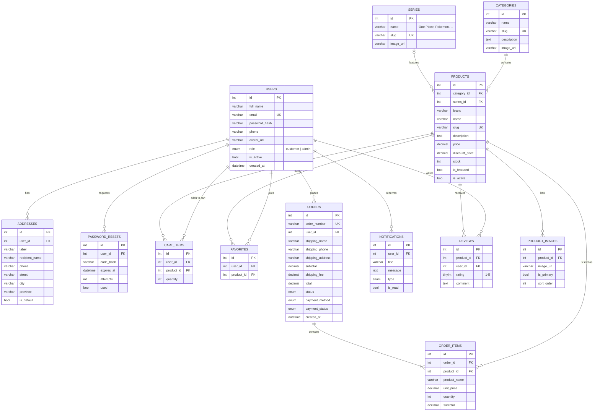

# Entity Relationship Diagram

The diagram below renders on GitHub. For a polished image for the report, paste
[`erd.dbml`](erd.dbml) into <https://dbdiagram.io> and export as PNG/PDF.

## Relationships

| Relationship | Type | Notes |
|---|---|---|
| User → Addresses | 1 : N | A user can save many shipping addresses |
| User → Cart items | 1 : N | One row per product in the cart; (user, product) is unique |
| User → Favorites | 1 : N | Wishlist; (user, product) is unique |
| User → Orders | 1 : N | |
| Order → Order items | 1 : N | Product name and price are copied at purchase time |
| Category → Products | 1 : N | Figures, Plush, TCG Boosters, ... |
| Series → Products | 1 : N | Anime franchise; optional (e.g. card sleeves have no series) |
| Product → Product images | 1 : N | One image is marked `is_primary` |
| User → Notifications | 1 : N | Order updates, promos |
| User/Product → Reviews | N : M | Bonus feature; one review per user per product |
