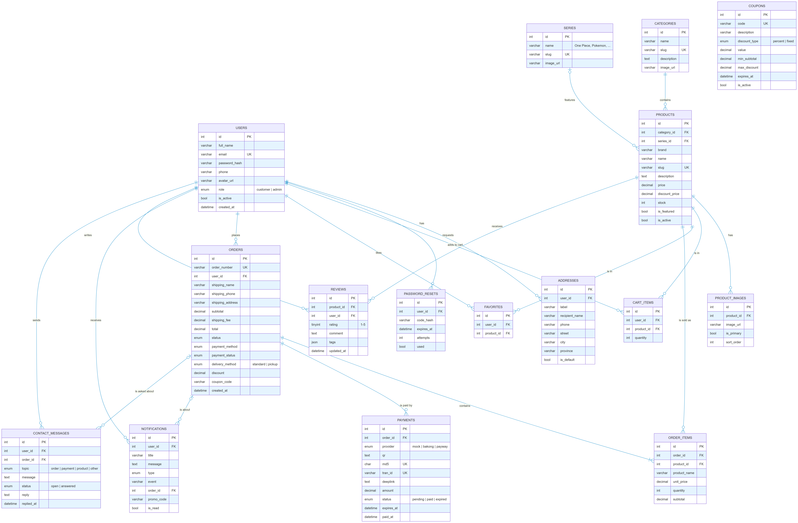
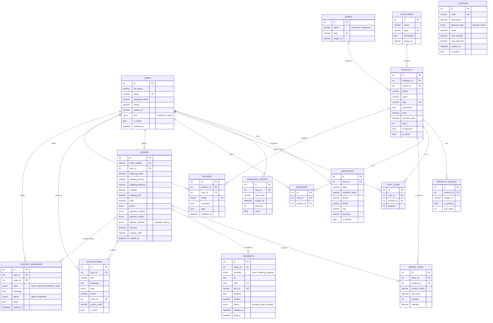

# Entity Relationship Diagram

All 16 tables with their keys and relationships. For the report use the ready
image [`erd.png`](erd.png) or [`erd.pdf`](erd.pdf). The same diagram is below
(GitHub draws it), and [`erd.dbml`](erd.dbml) opens in <https://dbdiagram.io>.

## Relationships

| Relationship | Type | Notes |
|---|---|---|
| User → Addresses | 1 : N | A user can save many shipping addresses |
| User → Cart items | 1 : N | One row per product in the cart; (user, product) is unique |
| User → Favorites | 1 : N | Wishlist; (user, product) is unique |
| User → Orders | 1 : N | |
| Order → Order items | 1 : N | Product name and price are copied at purchase time |
| Category → Products | 1 : N | Figures, Plush, TCG Boosters, ... |
| Series → Products | 1 : N | Anime franchise; optional (e.g. card sleeves have no series) |
| Product → Product images | 1 : N | One image is marked `is_primary` |
| User → Notifications | 1 : N | Order updates, promos, support replies; may point to an order |
| Order → Payments | 1 : N | KHQR / ABA PayWay attempts; the QR and its md5 are made once and reused while checking |
| User → Contact messages | 1 : N | Questions from the Contact screen; the shop's reply comes back as a notification |
| Order → Contact messages | 1 : N | Optional, only for order and payment questions |
| User/Product → Reviews | N : M | Bonus feature; one review per user per product |
