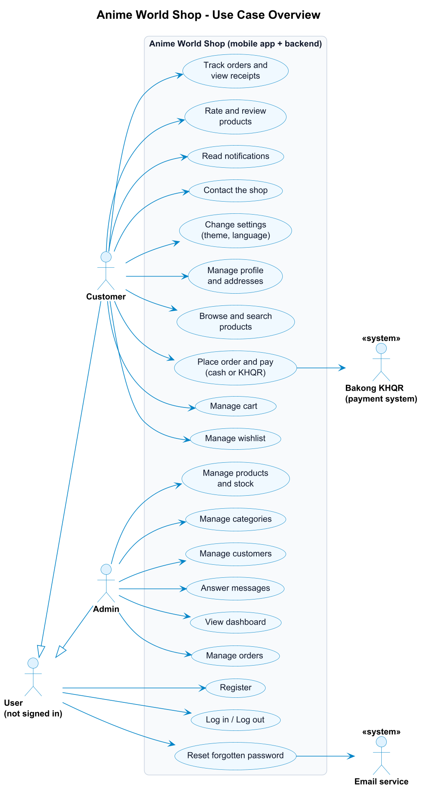
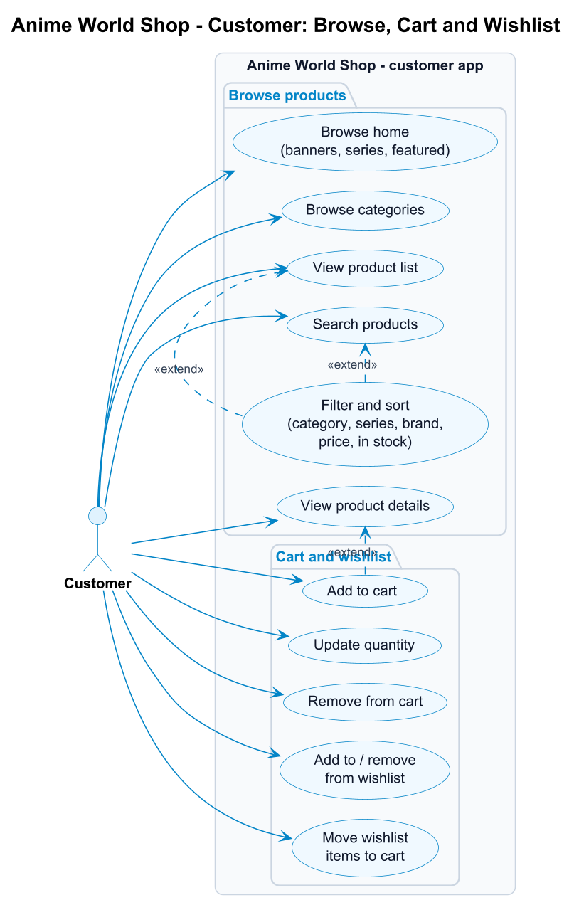
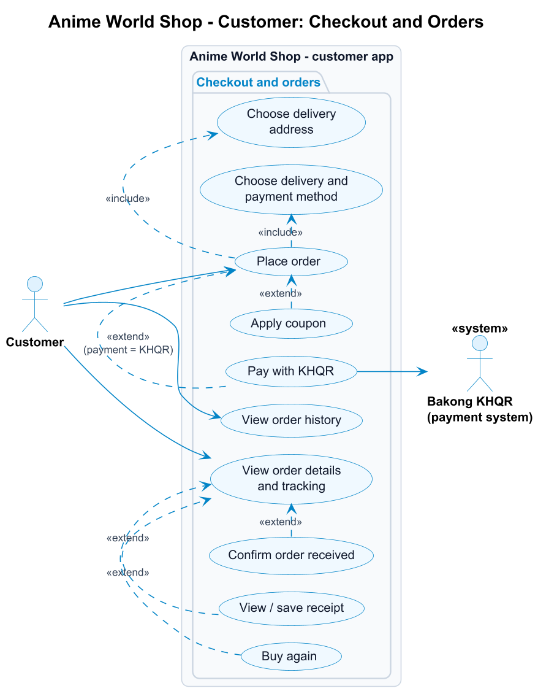
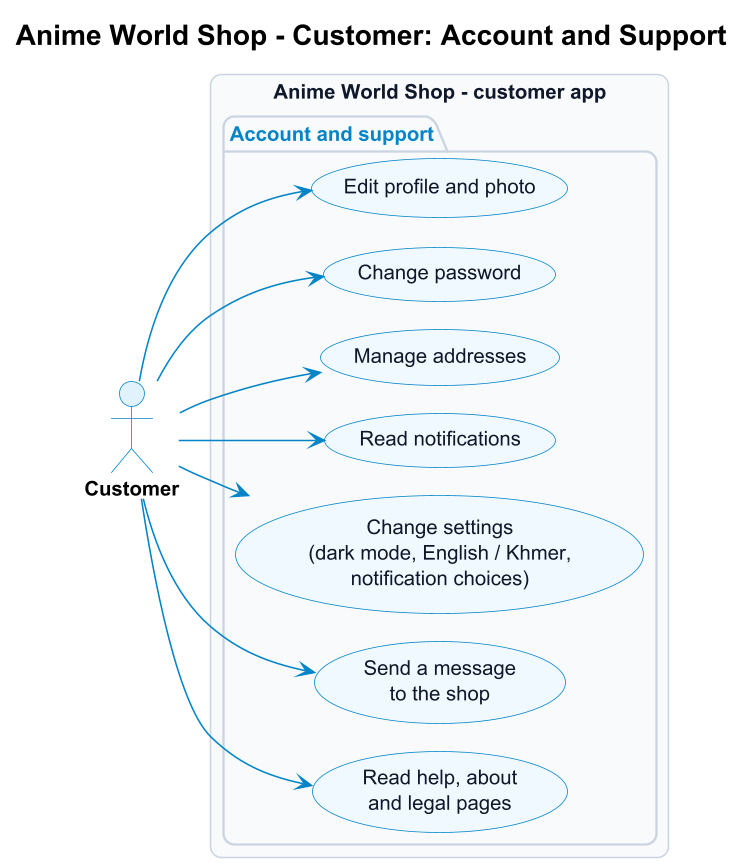
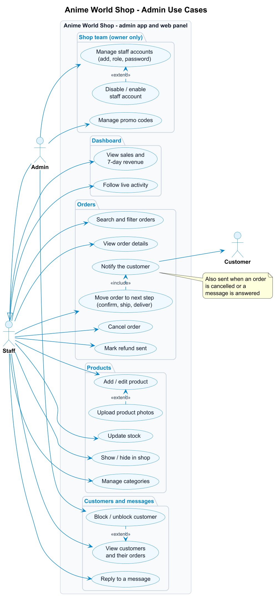

# Use Case Diagram and Specifications - Anime World Shop

Related documents: [Requirement Analysis](REQUIREMENTS.md) - [ERD](../database/ERD.md) - [API documentation](../API.md)

The diagrams are written in PlantUML ([`diagrams/*.puml`](diagrams/)) and exported as PNG. To change one, edit the `.puml` file and run:

```bash
java -jar plantuml.jar -tpng -Sdpi=150 docs/requirements/diagrams/use-case-*.puml
```

The Word copies (`.docx`) are made from these Markdown files with `python make_docx.py docs/requirements` (needs `pip install pypandoc_binary python-docx`); the PDFs are exported from Word.

---

## 1. Actors

| Actor | Type | Description |
|---|---|---|
| **User (not signed in)** | Primary | Anyone who opens the app without being logged in. Can only register, log in or reset a password. |
| **Customer** | Primary | A registered shopper. A specialisation of User: everything a User can do, plus shopping. |
| **Admin** | Primary | The shop owner or staff. A specialisation of User. Uses the admin tabs of the app, the React web admin at `/dashboard` or the panel at `/admin`. |
| **Bakong KHQR** | Secondary (external system) | Cambodia's national QR payment network. Receives KHQR payment requests and reports when they are paid. |
| **Email service** | Secondary (external system) | Sends the 6-digit password reset codes. |

---

## 2. Use case diagrams

### 2.1 Overview - all actors



`<<include>>` = always part of the base use case. `<<extend>>` = optional extra behaviour that happens only in some cases.

### 2.2 Customer - browse, cart and wishlist



### 2.3 Customer - checkout and orders



### 2.4 Customer - account and support



### 2.5 Admin



---

## 3. Use case list

| ID | Use case | Actor | Requirement | Screen(s) |
|---|---|---|---|---|
| UC-01 | Register | User | FR-U02 | Register |
| UC-02 | Log in / log out | User | FR-U03, FR-U09 | Login, Profile |
| UC-03 | Reset forgotten password | User, Email service | FR-U04 | Forgot Password, Verify Code, Reset Password |
| UC-04 | Edit profile and photo | Customer | FR-U05, FR-U06 | Profile, Edit Profile |
| UC-05 | Change password | Customer, Admin | FR-U07 | Change Password |
| UC-06 | Manage addresses | Customer | FR-U08 | My Addresses, Address Form |
| UC-07 | Browse home and categories | Customer | FR-P01, FR-P02 | Home, Categories |
| UC-08 | Search, filter and sort products | Customer | FR-P05, FR-P06 | Search, Product List, Filter |
| UC-09 | View product details | Customer | FR-P04 | Product Details |
| UC-10 | Add to cart | Customer | FR-C01 | Product List, Product Details |
| UC-11 | Update quantity / remove from cart | Customer | FR-C02, FR-C03 | Cart |
| UC-12 | Manage wishlist | Customer | FR-C06 | Wishlist |
| UC-13 | Place order (checkout) | Customer | FR-O01 - FR-O03 | Checkout, Order Placed |
| UC-14 | Apply coupon | Customer | FR-C05 | Cart |
| UC-15 | Pay with KHQR | Customer, Bakong KHQR | FR-O04 | KHQR Payment |
| UC-16 | View order history and details | Customer | FR-O05, FR-O06 | My Orders, Order Details |
| UC-17 | Confirm received / buy again / view receipt | Customer | FR-O07 | Order Details, Receipt |
| UC-18 | Read notifications | Customer | FR-A01 | Notifications |
| UC-19 | Change settings | Customer, Admin | FR-A02 | Settings |
| UC-20 | Send a message to the shop | Customer | FR-A04 | Contact Us |
| UC-21 | Read help, about and legal pages | Customer | FR-A03, FR-A05 | Help, About, Legal |
| UC-22 | Rate a product (edit / delete my review) | Customer | FR-R01, FR-R02 | Rate sheet (from Order Details, Notifications, To review, Product Details) |
| UC-23 | Read reviews | Customer | FR-R03, FR-R04 | Product Details, Reviews |
| UC-A1 | View dashboard and live activity | Admin | FR-AD01 | Admin Dashboard |
| UC-A2 | Manage orders (next step, cancel) | Admin | FR-AD02 | Admin Orders, Admin Order Details |
| UC-A3 | Add / edit product and photos | Admin | FR-AD03 | Admin Products, Add / Edit Product |
| UC-A4 | Update stock, show / hide product | Admin | FR-AD03 | Admin Products |
| UC-A5 | Manage categories | Admin | FR-AD04 | Admin Categories |
| UC-A6 | View and block / unblock customers | Admin | FR-AD05 | Admin Customers, Customer Details |
| UC-A7 | Reply to a message | Admin | FR-AD06 | Admin Messages |

---

## 4. Use case specifications

The main use cases in detail. Numbers in the flows are steps; "A" flows are alternatives or errors that branch off a step.

### UC-01 Register

| | |
|---|---|
| **Actor** | User (not signed in) |
| **Goal** | Create a customer account and start shopping. |
| **Precondition** | The user has no account with this email. |
| **Trigger** | The user taps "Create account" on the Login screen. |

**Main flow**
1. The user enters full name, email, phone (optional) and password, and ticks "I agree to the Terms & Privacy Policy".
2. The app checks the fields and sends `POST /api/auth/register`.
3. The system validates the data, stores the password as a bcrypt hash and creates the account with the role *customer*.
4. The system returns a login token and creates a welcome notification.
5. The app saves the token and opens the Home screen.

**Alternative flows**
- A1 (step 2/3): a field is wrong (empty name, invalid email, password shorter than 6 characters, invalid phone). The system returns `422` with the wrong fields; the app shows each message under its field.
- A2 (step 3): the email is already registered. `422`; the app shows "Email is already registered" under the email field.
- A3: no connection. The app shows "Cannot connect to server. Check your internet connection."

**Postcondition** A new customer account exists and the user is logged in.

### UC-02 Log in

| | |
|---|---|
| **Actor** | User (not signed in) - becomes Customer or Admin |
| **Precondition** | The user has an account. |

**Main flow**
1. The user enters email and password and taps Log in.
2. The app sends `POST /api/auth/login`.
3. The system checks the password against the stored hash and that the account is active.
4. The system returns a JWT (valid 7 days) and the user's profile, including the role.
5. The app opens the shop for a customer, or the Admin Dashboard for an admin.

**Alternative flows**
- A1 (step 3): wrong email or password. `401`, "Incorrect email or password"; the fields shake.
- A2 (step 3): the account is blocked. `403`, "This account has been disabled".

**Postcondition** The token is stored on the device; the user stays logged in until they log out (UC-02 log out: confirm dialog, token deleted, Login screen shown).

### UC-03 Reset forgotten password

| | |
|---|---|
| **Actors** | User, Email service |
| **Precondition** | The user has an account but forgot the password. |

**Main flow**
1. On Login the user taps "Forgot password?" and enters their email.
2. The system creates a 6-digit code valid for 10 minutes, stores only its hash, and sends it by email.
3. The user enters the code on the Verify Code screen.
4. The system checks the code and returns a short-lived reset token (15 minutes).
5. The user enters and confirms a new password.
6. The system saves the new password hash and marks the code as used.
7. The app shows "Password changed" and returns to Login.

**Alternative flows**
- A1 (step 2): the email is not registered. The app shows the same "code sent" message, so nobody can find out which emails have accounts.
- A2 (step 2): the user asks again within 60 seconds ("Please wait Ns before requesting a new code") or more than 5 times in an hour ("Too many code requests. Please try again in an hour."). `429`; the Resend button counts down.
- A3 (step 4): wrong code, or older than 10 minutes. `400`, "The code is incorrect or has expired".
- A4 (step 4): 5 wrong tries. `429`, "Too many wrong attempts. Please request a new code." The code is locked.

**Postcondition** The account has the new password; the old one no longer works.

### UC-08 Search, filter and sort products

| | |
|---|---|
| **Actor** | Customer |
| **Precondition** | Logged in. |

**Main flow**
1. The customer taps the search bar on Home.
2. The app shows recent searches; as the customer types, it shows suggestions (`GET /api/search/suggestions`).
3. The customer submits a search or picks a suggestion.
4. The system returns matching active products (name, brand or series) a page at a time.
5. The customer opens Filters and chooses category, series, brands, price range and "in stock only", and a sort order.
6. The app reloads the list with those filters (`GET /api/products?q=&category_id=&brand=&min_price=&max_price=&in_stock=1&sort=`) and shows the active filters as chips.

**Alternative flows**
- A1 (step 4): nothing matches. The app shows an empty state ("Try removing a filter.").
- A2: the customer removes a chip, or taps "Clear all"; the list reloads without those filters.

**Postcondition** The customer sees the products that match.

### UC-10 Add to cart

| | |
|---|---|
| **Actor** | Customer |
| **Extends** | UC-09 View product details (and the product list) |

**Main flow**
1. The customer taps "Add to cart" on a product.
2. The app sends `POST /api/cart` with the product and quantity.
3. The system checks that the product is active and in stock, then adds the line or increases its quantity.
4. The app plays the cart animation, updates the Cart badge and shows "Added to your cart" with a View cart button.

**Alternative flows**
- A1 (step 3): sold out (`409`, "This item is sold out") or the cart would exceed the stock (`409`, "Only N can be added for this item"). The app shows the message and nothing is added.

**Postcondition** The cart contains the product.

### UC-13 Place order (checkout)

| | |
|---|---|
| **Actor** | Customer |
| **Includes** | Choose delivery address; choose delivery and payment method |
| **Extended by** | UC-14 Apply coupon; UC-15 Pay with KHQR |
| **Precondition** | Logged in; the cart is not empty. |

**Main flow**
1. In the Cart the customer taps "Go to checkout".
2. The app loads `GET /api/checkout`: cart lines, addresses, delivery options and totals.
3. The customer chooses (or adds) a delivery address.
4. The customer chooses Standard delivery ($2, free from $50) or Store pickup (free).
5. The customer chooses KHQR or Cash on delivery and can add a note.
6. The customer taps "Place order"; the app sends `POST /api/orders`.
7. The system checks every line against the current stock, then in one transaction takes the stock (a conditional update, so the last item can't be sold twice), creates the order (number like `AWS-20261016-00042`) and its items, and empties the cart.
8. The system creates an "Order placed" notification.
9. Cash on delivery: the app shows the Order Placed screen. KHQR: continue with UC-15.

**Alternative flows**
- A1 (step 3): no address yet. The app opens the Address Form first.
- A2 (step 7): an item sold out or has less stock than ordered since it was added. `409`, e.g. "Some items changed. Only 1 left of Nendoroid Anya Forger."; nothing is ordered and the customer can fix the cart.
- A4 (step 6): the cart is empty. `409`, "Your cart is empty".
- A3 (step 6): no payment method chosen. `422`, "Choose KHQR or Cash on delivery".

**Postcondition** A *pending* order exists, stock is reserved and the cart is empty.

### UC-15 Pay with KHQR

| | |
|---|---|
| **Actors** | Customer, Bakong KHQR |
| **Extends** | UC-13 Place order, when the payment method is KHQR |
| **Precondition** | A pending, unpaid KHQR order. |

**Main flow**
1. The app requests a payment (`POST /api/orders/<id>/khqr`).
2. The system generates a KHQR code for the order total with the shop's Bakong account and stores its MD5 reference. The code expires after 15 minutes.
3. The app shows the QR, the amount and a countdown.
4. The customer scans the code with any Cambodian bank app (ABA, ACLEDA, Wing ...) and pays.
5. The app checks the status every few seconds (`GET /api/orders/<id>/payment`); the system asks Bakong whether that reference is paid.
6. When Bakong reports *paid*, the system marks the payment and the order as paid and sends a "Payment received" notification.
7. The app prints out the receipt and offers Save receipt, View order and Continue shopping.

**Alternative flows**
- A1 (step 5): 15 minutes pass without payment. The order is cancelled and its stock returned; the app shows "This QR code expired" and a Try again button.
- A2 (step 5): the customer taps "I've paid - check now" to check straight away instead of waiting for the next automatic check.

**Postcondition** The order is *paid* and waits for the shop to confirm it.

### UC-16 View order history and details

| | |
|---|---|
| **Actor** | Customer |

**Main flow**
1. The customer opens My Orders from Profile.
2. The app shows orders in progress (with an animated tracker) and past orders (`GET /api/orders`).
3. The customer opens an order; the app shows the tracker (placed, paid, shipped, delivered), the items with photos, the address, the payment and the totals.
4. Optional (UC-17): when the order is on the way the customer taps "Got it" to confirm it was received; for a finished order they can tap "Buy again" (the items go back into the cart); for a paid order they can view, save or share the receipt.

**Alternative flows**
- A1 (step 2): no orders yet. Empty state with "Start shopping".

### UC-22 Rate a product

| | |
|---|---|
| **Actor** | Customer |
| **Precondition** | The product is in one of the customer's delivered orders. |
| **Trigger** | "Rate it" on an item of a delivered order, on the "Delivered" notification, in Profile > To review, or "You bought this. Rate it" on the product page. |

**Main flow**
1. The app opens the rating sheet with the product photo and name ("Rate your figure").
2. The customer taps a star; the star pops and the word under it changes (Terrible ... Excellent). Post review stays disabled until a star is chosen.
3. The customer may pick quick tags and write a comment.
4. The customer taps Post review; the app sends `POST /api/products/<id>/reviews`.
5. The system checks that the product was delivered to them, validates the data and saves the review (or updates their existing one).
6. The sheet shows "Thanks for your review!" and closes; the item now shows its stars and "Reviewed", and the product's rating is updated.

**Alternative flows**
- A1 (step 5): not delivered to this customer. `403`, "You can review a product once it has been delivered to you".
- A2 (step 5): comment longer than 1,000 characters, unknown tag or rating not 1-5. `422`; the sheet shows the message and stays open.
- A3: the customer already reviewed it. The sheet opens as "Edit your review" with their stars, tags and comment; Save changes edits it, Delete review (after a confirmation) removes it.

**Postcondition** The review is on the product page and the Reviews page, marked as a verified buyer.

### UC-A2 Manage orders

| | |
|---|---|
| **Actor** | Admin |
| **Includes** | Notify the customer |
| **Precondition** | Logged in as admin. |

**Main flow**
1. The admin opens the Orders tab (the badge shows how many orders need handling).
2. The app lists all orders (`GET /api/admin/orders`) with counts per status; the admin can search by order number or customer, or filter by status.
3. The admin taps the order's next-step button (Confirm, Ship or Delivered), or opens the order details first.
4. The system checks that the step is allowed (pending -> confirmed -> shipped -> delivered) and saves the new status (`PUT /api/admin/orders/<id>/status`).
5. The system creates a notification for the customer ("Your order has shipped" ...).
6. The app updates the list, the badge and the dashboard.

**Alternative flows**
- A1 (step 3): the admin taps Cancel. The app asks "Cancel this order?"; on confirm the order is cancelled, its stock returned and the customer notified.
- A2 (step 4): the step is not allowed (e.g. shipping a pending order, cancelling a shipped one). `409`, "A shipped order cannot be marked cancelled".
- A3 (step 4): an unpaid KHQR order can only be cancelled, not confirmed.

**Postcondition** The order has its new status and the customer knows.

### UC-A3 Add / edit product

| | |
|---|---|
| **Actor** | Admin |
| **Extended by** | Upload product photos |

**Main flow**
1. The admin taps the raised + button (or a product in the Products tab to edit it).
2. The admin fills in name, category, series, brand, price, sale price, stock, description, Featured and In the shop, and picks photos from the gallery.
3. The admin taps "Save product"; the app sends `POST /api/admin/products` (or `PUT` for an edit).
4. The system validates the data and saves the product with a URL slug.
5. The app uploads each new photo (`POST /api/admin/products/<id>/images`); the first one becomes the main photo.
6. The product appears in the shop (if "In the shop" is on).

**Alternative flows**
- A1 (step 4): a field is wrong (no name, price not a number, sale price not lower than the price, negative stock). `422`; the app shows each message under its field.
- A2 (step 5): a photo is not a JPG, PNG or WebP image, or is larger than 5 MB. `422`; that photo is refused with a message and the product is still saved. Accepted photos are cropped square and stored as WebP.

**Postcondition** The product exists with its photos.

### UC-A6 View and block / unblock customers

| | |
|---|---|
| **Actor** | Admin |

**Main flow**
1. From More, the admin opens Customers and can search by name, email or phone, or filter All / Active / Blocked.
2. The admin opens a customer and sees their contact details, orders, total spent and addresses.
3. The admin taps "Block customer" and confirms.
4. The system marks the account inactive (`PUT /api/admin/customers/<id>`).
5. From now on the customer's login and any existing token are refused (`403`).

**Alternative flows**
- A1: the admin taps "Unblock customer"; the account is active again at once.

**Postcondition** The customer can, or can no longer, use the shop.

### UC-A7 Reply to a message

| | |
|---|---|
| **Actors** | Admin (and the Customer who receives the answer) |
| **Includes** | Notify the customer |

**Main flow**
1. The admin opens Messages (from More or the dashboard feed); open questions are listed first.
2. The admin taps Reply, writes the answer and taps "Send reply".
3. The system saves the reply, marks the message *answered* (`POST /api/admin/contact-messages/<id>/reply`) and notifies the customer.
4. The message moves to the Answered list.

**Postcondition** The customer sees the answer in Notifications and on the Contact screen.
